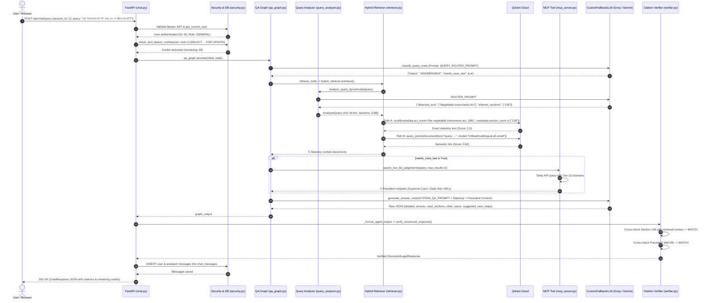

# Architecture Audit & Technical Verification: Advotech Copilot

---

## 1. Executive Summary

**Advotech Copilot** (internally referenced as **ContractMind**) is a production-oriented legal AI and contract auditing backend designed specifically for **Bangladesh statutory and case law**. The system operates on a dual-engine architecture:
1. **Conversational Legal QA Engine**: A retrieval-augmented generation (RAG) system grounded in over 43,000 sections of the Bangladesh Code, augmented with live judicial precedent search via the Model Context Protocol (MCP) tool layer.
2. **Contract Audit & Human-In-The-Loop (HITL) Engine**: An automated contract risk analysis pipeline that extracts clauses, audits them against Bangladesh statutes and corporate playbooks, flags statutory violations (such as restraint of trade or penalty clauses), and orchestrates lawyer review and verification.

### Core Architectural Mechanics
- **API & Framework**: Built on **FastAPI 0.115.0** using an asynchronous lifecycle (`lifespan`) supporting background cron scheduling via **APScheduler**.
- **Data Persistence**: Uses **Supabase PostgreSQL** via asynchronous SQLAlchemy 2.0 (`asyncpg` driver) with strict row-locking (`SELECT ... FOR UPDATE`) for transaction integrity, credit balance management, and tiered query limits.
- **AI Orchestration**: Employs **LangGraph** (StateGraph workflows) to drive multi-step reasoning, query classification, context-driven document retrieval, and citation-verified structured generation.
- **LLM Strategy**: Implements a primary/fallback architecture in [`app/services/llm_provider.py`](file:///c:/Users/tasin/Downloads/test/legal-copilot-backend/app/services/llm_provider.py): primary inference runs on **Groq** (`qwen/qwen3.8-27b`), automatically failing over to **Google Gemini** (`gemini-3.5-flash-lite`) if Groq experiences rate limits or timeouts.
- **RAG & Search**: Powered by **Qdrant Cloud** hosting dense 384-dimensional vector embeddings generated using `intfloat/multilingual-e5-small`. Retrieval is a two-path hybrid system combining exact statutory section lookups with dense semantic search.
- **MCP Integration**: An MCP server is defined via **FastMCP** exposing 3 tools. The QA LangGraph workflow directly executes the live judgment search tool via internal Python async calls, while the server can independently run as a standalone stdio process.

---

## 2. Project Structure Map

```
legal-copilot-backend/
├── app/
│   ├── main.py                  # Entry point: FastAPI app, CORS, lifespan, router registration
│   ├── config.py                # Environment & Pydantic V2 BaseSettings management
│   ├── agents/                  # LangGraph agent definitions, state schemas, and prompts
│   │   ├── state.py             # QAState, ContractState, and ClauseRisk TypedDict schemas
│   │   ├── prompts.py           # System prompts for QA, clause extraction, and contract risk
│   │   ├── nodes.py             # Contract graph execution nodes (statute retrieval & risk)
│   │   ├── qa_graph.py          # StateGraph workflow for legal QA (classify -> retrieve -> generate)
│   │   └── contract_graph.py    # StateGraph workflow for contract auditing
│   ├── api/                     # REST API routers (endpoints, request/response models)
│   │   ├── auth.py              # User onboarding, email OTP, Google OAuth, and JWT authentication
│   │   ├── admin.py             # Superadmin dashboard, lawyer/enterprise approval, credit top-up
│   │   ├── company.py           # Enterprise tenant management, member approval, playbook management
│   │   ├── chat.py              # Legal chat sessions, credit deductions, and QA query processing
│   │   ├── contract.py          # Contract upload, text extraction, AI audit, and HITL verification
│   │   ├── lawyer.py            # Lawyer workspace: review queues, accepting reviews, payouts
│   │   ├── payments.py          # bKash manual payment initiation, verification, and credit packs
│   │   └── settings.py          # User profile settings, avatar upload, password changes
│   ├── core/                    # Core infrastructure: database, security, and pricing
│   │   ├── database.py          # Async SQLAlchemy engine, async_sessionmaker, PgBouncer settings
│   │   ├── security.py          # Password hashing (bcrypt), JWT tokens, RBAC, credit row-locks
│   │   ├── tier_limits.py       # Session limits, monthly chat quotas by user role
│   │   └── pricing.py           # Single source of truth for credit pricing, BDT values, and payouts
│   ├── models/                  # SQLAlchemy ORM declarative models
│   │   ├── __init__.py          # Unified model imports resolving all foreign keys and relations
│   │   ├── user.py              # User, Enterprise, CreditTransaction, WithdrawalRequest models
│   │   ├── chat.py              # ChatSession, ChatMessage models
│   │   ├── lawyer.py            # LawyerProfile model with bar council details and ratings
│   │   ├── memo.py              # Contract, ContractMemo models (storing AI audit & HITL status)
│   │   ├── playbook.py          # CompanyPlaybook and CreditPackage models
│   │   └── audit.py             # Payment and AuditLog models
│   └── services/                # Business logic, external integrations, and search engines
│       ├── llm_provider.py      # CustomFallbackLLM (Groq primary -> Gemini fallback)
│       ├── vector_store.py      # QdrantVectorManager client configured for cloud inference
│       ├── retriever.py         # ProductionHybridRetriever (Targeted statutory lookup + dense search)
│       ├── query_analyzer.py    # Dynamic legal query analyzer (extracts Acts and sections)
│       ├── legal_normalizer.py  # Bengali/English digit, section, and Act canonical normalization
│       ├── verifier.py          # CitationVerifier (regex and context cross-referencing)
│       ├── mcp_server.py        # FastMCP server exposing 3 legal search/verification tools
│       ├── ingestion.py         # PDF, DOCX, and scanned document OCR processor (Vision & Lens API)
│       ├── playbook_parser.py   # Corporate playbook policy extractor (LLM rule structuring)
│       ├── lawyer_assignment.py # SLA monitoring, lawyer matching, and task reallocation logic
│       ├── email_service.py     # Gmail API and SMTP email dispatch with demo file fallback
│       └── cron.py              # APScheduler background tasks (15-min and 1-hour cron jobs)
├── data/
│   └── laws/                    # Target directory for cached Bangladesh statute datasets
├── scripts/                     # Operational, data seeding, and re-indexing scripts
│   ├── reingest_small.py        # Batch ingestion into Qdrant using multilingual-e5-small
│   ├── scrape_laws.py           # Scrapes/extracts laws from HuggingFace dataset (Ashik2380/bdlaws)
│   ├── scrape_judgements.py     # Scrapes judicial notices from supremecourt.gov.bd
│   ├── seed_packages.py         # Seeds default credit packages into the database
│   └── reset_db.py              # Development utility to purge and reinitialize tables
├── act_aliases.json             # 3,527 Act alias mappings for canonical statute resolution
└── requirements.txt             # Project dependencies
```

---

## 3. API and Service Map

| HTTP Method & Path | Router Module | Auth & Permissions | Request Schema | Controller / Service Called | DB Reads / Writes | RAG / MCP / LLM Operations | Response Schema |
|---|---|---|---|---|---|---|---|
| `POST /api/auth/register/email` | [`auth.py`](file:///c:/Users/tasin/Downloads/test/legal-copilot-backend/app/api/auth.py#L205) | Public | `EmailRegisterRequest` | `send_otp_email` | Reads: `User`<br>Writes: `User` (inactive) | None | `RegisterResponse` |
| `POST /api/auth/verify-otp` | [`auth.py`](file:///c:/Users/tasin/Downloads/test/legal-copilot-backend/app/api/auth.py#L240) | Public | `VerifyOtpRequest` | `create_access_token` | Reads: `User`<br>Writes: `User` (active, bonus credits) | None | `Token` |
| `POST /api/auth/login` | [`auth.py`](file:///c:/Users/tasin/Downloads/test/legal-copilot-backend/app/api/auth.py#L336) | Public | `LoginRequest` | `verify_password`, `create_access_token` | Reads: `User`<br>Writes: `User.last_login_at` | None | `Token` |
| `POST /api/auth/login/google` | [`auth.py`](file:///c:/Users/tasin/Downloads/test/legal-copilot-backend/app/api/auth.py#L346) | Public | `GoogleLoginRequest` | `id_token.verify_oauth2_token` | Reads: `User`<br>Writes: `User` | None | `Token` |
| `GET /api/auth/me` | [`auth.py`](file:///c:/Users/tasin/Downloads/test/legal-copilot-backend/app/api/auth.py#L427) | Authenticated | None | `get_current_user` | Reads: `User`, `LawyerProfile`, `Enterprise` | None | `UserResponse` |
| `POST /api/chat/sessions` | [`chat.py`](file:///c:/Users/tasin/Downloads/test/legal-copilot-backend/app/api/chat.py#L175) | Authenticated (Lawyer for `LAWYER_RESEARCH`) | `CreateSessionRequest` | `get_max_active_sessions` | Reads: `ChatSession`, `Contract`<br>Writes: `ChatSession` | None | `dict` (session info) |
| `GET /api/chat/sessions` | [`chat.py`](file:///c:/Users/tasin/Downloads/test/legal-copilot-backend/app/api/chat.py#L232) | Authenticated | Query Params | Database query | Reads: `ChatSession` | None | `List[dict]` |
| `GET /api/chat/sessions/{id}` | [`chat.py`](file:///c:/Users/tasin/Downloads/test/legal-copilot-backend/app/api/chat.py#L260) | Authenticated (Owner) | Path: `id` | Database query | Reads: `ChatSession`, `ChatMessage` | None | `dict` (full history) |
| `POST /api/chat/query` | [`chat.py`](file:///c:/Users/tasin/Downloads/test/legal-copilot-backend/app/api/chat.py#L322) | Authenticated (Credits check) | `QueryRequest` | `check_and_deduct_credits`, `qa_graph.ainvoke`, `_format_agent_output` | Reads: `ChatSession`, `ChatMessage`, `ContractMemo`<br>Writes: `ChatMessage`, `ChatSession`, `CreditTransaction` | **RAG**: Qdrant hybrid retrieval<br>**MCP**: `search_live_bd_judgements`<br>**LLM**: Classification, generation & rolling summary | `ChatResponse` |
| `POST /api/contracts/upload` | [`contract.py`](file:///c:/Users/tasin/Downloads/test/legal-copilot-backend/app/api/contract.py#L128) | Authenticated (Credits check) | Multipart Form: `file`, `title` | `extract_text_from_file`, `_upload_to_supabase`, `analyze_contract_risk_async` | Reads: `CompanyPlaybook`<br>Writes: `Contract`, `ContractMemo`, `CreditTransaction` | **RAG**: Statute retrieval (`hybrid_retriever`)<br>**LLM**: Contract clause & risk assessment | `ContractMemoResponse` |
| `POST /api/contracts/{id}/request-verification` | [`contract.py`](file:///c:/Users/tasin/Downloads/test/legal-copilot-backend/app/api/contract.py#L256) | Authenticated (Owner) | Path: `id` | `check_and_deduct_credits`, `generate_initial_offer` | Reads: `Contract`, `ContractMemo`<br>Writes: `ContractMemo`, `CreditTransaction` | None | `RequestVerificationResponse` |
| `GET /api/contracts/history` | [`contract.py`](file:///c:/Users/tasin/Downloads/test/legal-copilot-backend/app/api/contract.py#L326) | Authenticated | Query Params | Database query | Reads: `Contract`, `ContractMemo` | None | `List[dict]` |
| `GET /api/contracts/{id}/download` | [`contract.py`](file:///c:/Users/tasin/Downloads/test/legal-copilot-backend/app/api/contract.py#L390) | Authenticated (Owner) | Path: `id` | Supabase Storage SDK | Reads: `Contract`, `ContractMemo` | None | `dict` (signed download URL) |
| `GET /api/lawyer/queue` | [`lawyer.py`](file:///c:/Users/tasin/Downloads/test/legal-copilot-backend/app/api/lawyer.py#L69) | Role: `LAWYER` | None | Database query | Reads: `ContractMemo`, `LawyerProfile` | None | `List[dict]` |
| `POST /api/lawyer/queue/{id}/accept` | [`lawyer.py`](file:///c:/Users/tasin/Downloads/test/legal-copilot-backend/app/api/lawyer.py#L88) | Role: `LAWYER` | Path: `id` | `send_client_lawyer_assigned_email` | Reads: `ContractMemo`<br>Writes: `ContractMemo` | None | `dict` |
| `POST /api/lawyer/active/{id}/submit` | [`lawyer.py`](file:///c:/Users/tasin/Downloads/test/legal-copilot-backend/app/api/lawyer.py#L165) | Role: `LAWYER` | Form: `lawyer_notes`, `signed_pdf` | `_upload_to_supabase`, `send_client_verification_complete_email` | Reads: `ContractMemo`<br>Writes: `ContractMemo`, `LawyerProfile.wallet_balance` | None | `dict` |
| `POST /api/company/playbook/upload` | [`company.py`](file:///c:/Users/tasin/Downloads/test/legal-copilot-backend/app/api/company.py#L637) | Role: `ENTERPRISE_ADMIN` | Multipart Form: `title`, `file` | `extract_text_from_file`, `parse_playbook_to_rules` | Reads: `CompanyPlaybook`<br>Writes: `CompanyPlaybook`, `AuditLog` | **LLM**: Gemini structuring of playbook rules | `dict` |
| `POST /api/payments/initiate` | [`payments.py`](file:///c:/Users/tasin/Downloads/test/legal-copilot-backend/app/api/payments.py#L225) | Authenticated | `InitiatePaymentRequest` | Database creation | Reads: `CreditPackage`<br>Writes: `Payment` | None | `dict` (bKash instructions) |
| `POST /api/payments/{id}/submit-trx` | [`payments.py`](file:///c:/Users/tasin/Downloads/test/legal-copilot-backend/app/api/payments.py#L350) | Authenticated (Payer) | `SubmitTrxRequest` | Database update | Reads: `Payment`<br>Writes: `Payment.trx_id` | None | `dict` |
| `POST /api/admin/payments/{id}/approve` | [`admin.py`](file:///c:/Users/tasin/Downloads/test/legal-copilot-backend/app/api/admin.py#L423) | Role: `ADMIN` | Path: `id` | Balance update with row-locking | Reads: `Payment`, `User`, `Enterprise`<br>Writes: `Payment`, `User`, `Enterprise`, `CreditTransaction` | None | `dict` |

---

## 4. RAG Architecture Diagram

```mermaid
flowchart TD
    subgraph INGESTION["Phase A: Data Ingestion & Pre-Indexing"]
        A1["Ashik2380/bdlaws\nHuggingFace Dataset"] -->|scrape_laws.py| A2["all_bangladesh_laws.json\n(43,000+ Sections)"]
        A2 -->|reingest_small.py\nFastEmbed| A3["intfloat/multilingual-e5-small\n(384 Dim Vectors)"]
        A3 -->|Upsert in Batches of 500\nPrefix: 'passage: '| A4[("Qdrant Cloud\nCollection: bd_laws_e5_small")]
    end

    subgraph QUERY["Phase B: RAG Query Lifecycle"]
        B1["User Legal Query"] --> B2["app/api/chat.py\nLanguage Detection & Credit Deduction"]
        B2 --> B3["qa_graph: classify_query_node\n(LLM Query Classifier)"]
        
        B3 -->|If OUT_OF_SCOPE or NEEDS_CLARIFICATION| B4["Immediate Structured Answer\n(Bypass Search)"]
        B3 -->|If ANSWERABLE| B5["qa_graph: retrieve_node"]
        
        B5 --> B6["query_analyzer: analyze_query_dynamically"]
        B6 --> B7{"Query Analysis Output\n- detected_acts\n- explicit_sections\n- inferred_sections\n- optimized_query"}
        
        B7 -->|Path A: Exact Section Lookup| B8["legal_normalizer.resolve_act_robust\n& get_section_variants"]
        B8 -->|Qdrant Scroll Filter\nmetadata.act_norm & section_norm| B9["Exact Statutory Provisions\n(Score = 2.0 / 1.0)"]
        
        B7 -->|Path B: Dense Semantic Search| B10["vector_manager.similarity_search\nPrefix: 'query: ' | Cloud Inference"]
        B10 -->|Cosine Similarity Filter >= 0.36| B11["Semantic Matches\n(Score = Dense Cosine)"]
        
        B5 -->|If needs_case_law is True| B12["MCP Tool Call:\nsearch_live_bd_judgements"]
        B12 -->|Tavily API / DDGS Fallback\nGov (Tier 1) & News (Tier 2)| B13["Live High Court / Supreme Court\nPrecedents (Top 2)"]
        
        B9 & B11 --> B14["hybrid_retriever: Merge & Re-rank\n(+0.2 boost for dual-path hits)"]
        B14 & B13 --> B15["Top 5 Statutory Docs + 2 Precedent Hits"]
        
        B15 --> B16["qa_graph: generate_answer_node\n(Prompt Assembly: Statutes + Case Laws)"]
        B16 -->|If No Context Found| B17["NO_CONTEXT_ANSWER Fallback"]
        B16 -->|Context Available| B18["LLM Provider (Groq / Gemini)\nStrict JSON Generation"]
        
        B18 --> B19["verifier: CitationVerifier\n- Cross-check statutory sections\n- Cross-check precedent citations"]
        B19 --> B20["StructuredLegalResponse\nSaved to PostgreSQL chat_messages"]
    end
```

---

## 5. MCP Architecture Diagram

```mermaid
flowchart TD
    subgraph MCP_SERVER["FastMCP Server (app/services/mcp_server.py)"]
        M1["FastMCP Instance\n'Bangladesh-Legal-MCP-Server'"]
        
        subgraph REGISTERED_TOOLS["Registered @mcp.tool() Endpoints"]
            T1["search_live_bd_judgements(query, max_results)"]
            T2["get_statute_by_section(act_name, section_number)"]
            T3["verify_legal_citation(statute_act, cited_section)"]
        end
        
        M1 --> T1
        M1 --> T2
        M1 --> T3
    end

    subgraph EXECUTION_PATH["Tool Execution & Consumer Reality"]
        C1["qa_graph.py: retrieve_node"]
        
        C1 -->|Direct Python async invocation\n(Internal function call)| T1
        T1 --> D1{"Tavily API Key Available?"}
        
        D1 -->|Yes| D2["Tavily Search API\nTier 1: supremecourt.gov.bd, bdlaws.minlaw.gov.bd\nTier 2: thedailystar.net, dhakatribune.com"]
        D1 -->|No / 0 Results| D3["DuckDuckGo DDGS() Fallback\nSite-specific text search"]
        
        D2 & D3 --> D4["Sanitization & Filtering\n- _is_allowed(domain)\n- _looks_legal(signals)"]
        D4 --> D5["Return List[Dict]: title, snippet, reference_url, tier"]
        D5 --> C1
        
        T2 -.->|DISCONNECTED: Never invoked by any endpoint| U1["Direct Qdrant Client Scroll"]
        T3 -.->|DISCONNECTED: Never invoked by any endpoint| T2
    end

    subgraph STANDALONE["External MCP Client Access"]
        E1["External MCP Host\n(e.g., Claude Desktop / CLI)"]
        E1 -.->|stdio transport via mcp.run()| M1
    end
```

---

## 6. Complete Backend Integration Diagram

```mermaid
flowchart TD
    subgraph CLIENT["Client Layer"]
        User["Web / Mobile Browser (React / Next.js)"]
    end

    subgraph API_GW["FastAPI Application (app/main.py)"]
        MW["CORSMiddleware\n(localhost & *.vercel.app)"]
        AuthMid["HTTPBearer Dependency\napp/core/security.py: get_current_user"]
        
        R_Chat["/api/chat/query\n(app/api/chat.py)"]
        R_Contract["/api/contracts/upload\n(app/api/contract.py)"]
        R_Lawyer["/api/lawyer/active/{id}/submit\n(app/api/lawyer.py)"]
    end

    subgraph PERSISTENCE["Database & Storage"]
        PG[("PostgreSQL (Supabase)\nUsers, Sessions, Messages,\nContracts, Transactions")]
        Storage["Supabase Storage Bucket\n'contracts' (PDFs / Signed Docs)"]
    end

    subgraph ORCHESTRATION["LangGraph Workflows"]
        QA_Graph["qa_graph (app/agents/qa_graph.py)\nState: QAState"]
        Contract_Graph["contract_graph (app/agents/contract_graph.py)\nState: ContractState"]
    end

    subgraph RETRIEVAL["Hybrid RAG & External Search"]
        Hybrid["ProductionHybridRetriever\n(app/services/retriever.py)"]
        Qdrant[("Qdrant Cloud\nbd_laws_e5_small\n(384 Dim Cosine)")]
        MCP["MCP Live Search\n(app/services/mcp_server.py)"]
        Tavily["Tavily Search API\n(Official BD Domains)"]
        DDG["DuckDuckGo (DDGS)\n(Fallback)"]
    end

    subgraph AI_INFERENCE["LLM Provider (app/services/llm_provider.py)"]
        FallbackLLM["CustomFallbackLLM"]
        Groq["Primary: Groq Cloud\nModel: qwen/qwen3.8-27b"]
        Gemini["Fallback: Google GenAI\nModel: gemini-3.5-flash-lite"]
    end

    subgraph VERIFICATION["Validation & Formatting"]
        Verifier["CitationVerifier (app/services/verifier.py)"]
        Formatter["_format_agent_output (app/api/chat.py)"]
    end

    %% Client to API
    User -->|HTTP POST Request| MW
    MW --> AuthMid
    AuthMid -->|Authorized User| R_Chat
    AuthMid -->|Authorized User| R_Contract

    %% Chat Execution
    R_Chat -->|1. Deduct Credits (Row-Lock)| PG
    R_Chat -->|2. Invoke Workflow| QA_Graph
    QA_Graph -->|Classify & Retrieve| Hybrid
    Hybrid -->|Exact & Dense Lookup| Qdrant
    QA_Graph -->|Live Precedent Search| MCP
    MCP --> Tavily
    Tavily -.->|Fallback| DDG
    QA_Graph -->|Generate Answer| FallbackLLM
    FallbackLLM --> Groq
    Groq -.->|On 429/Timeout| Gemini
    QA_Graph -->|Parsed JSON| Formatter
    Formatter --> Verifier
    Verifier -->|Drop Hallucinations| Formatter
    Formatter -->|Persist Output| PG
    Formatter -->|Return Response| User

    %% Contract Execution
    R_Contract -->|Upload File| Storage
    R_Contract -->|Deduct Credits| PG
    R_Contract -->|Extract Text & Rules| Contract_Graph
    Contract_Graph -->|Retrieve Laws| Hybrid
    Contract_Graph -->|Risk Audit| FallbackLLM
    Contract_Graph -->|Save Contract & Memo| PG
    Contract_Graph -->|Return Audit Report| User
```

---

## 7. End-to-End Sequence Diagram



---

## 8. Function Call Chains

### Chain 1: Legal Chat Query & RAG Retrieval
```
Client HTTP Request: POST /api/chat/query
│
└── app.api.chat.process_chat_query() [app/api/chat.py:323]
    ├── app.core.security.get_current_user() [app/core/security.py:81]
    ├── app.core.security.detect_language() [app/core/security.py:176]
    ├── app.core.security.check_and_deduct_credits() [app/core/security.py:234]
    │   └── app.core.security._lock_user() [app/core/security.py:211] (SELECT FOR UPDATE)
    │
    └── app.agents.qa_graph.qa_graph.ainvoke() [app/agents/qa_graph.py:328]
        │
        ├── [Node 1] app.agents.qa_graph.classify_query_node() [app/agents/qa_graph.py:95]
        │   └── app.services.llm_provider.get_llm().ainvoke() [app/services/llm_provider.py:58]
        │
        ├── [Node 2] app.agents.qa_graph.retrieve_node() [app/agents/qa_graph.py:154]
        │   ├── app.services.retriever.ProductionHybridRetriever.aretrieve() [app/services/retriever.py:223]
        │   │   └── app.services.retriever.ProductionHybridRetriever.retrieve() [app/services/retriever.py:177]
        │   │       ├── app.services.query_analyzer.analyze_query_dynamically() [app/services/query_analyzer.py:116]
        │   │       │   └── LLM Invocation / fallback keyword parsing [app/services/query_analyzer.py:134]
        │   │       ├── app.services.retriever._targeted_lookup() [app/services/retriever.py:58]
        │   │       │   ├── app.services.legal_normalizer.resolve_act_robust() [app/services/legal_normalizer.py:65]
        │   │       │   ├── app.services.legal_normalizer.get_section_variants() [app/services/legal_normalizer.py:148]
        │   │       │   └── QdrantClient.scroll() [app/services/retriever.py:91]
        │   │       └── app.services.retriever._dense_semantic_search() [app/services/retriever.py:139]
        │   │           └── app.services.vector_store.QdrantVectorManager.similarity_search() [app/services/vector_store.py:23]
        │   │               └── QdrantClient.query_points(cloud_inference=True) [app/services/vector_store.py:38]
        │   │
        │   └── [MCP Execution] app.services.mcp_server.search_live_bd_judgements() [app/services/mcp_server.py:104]
        │       ├── app.services.mcp_server._tavily_search_sync() [app/services/mcp_server.py:75]
        │       └── app.services.mcp_server._ddg_one_site_sync() [app/services/mcp_server.py:91] (Fallback)
        │
        └── [Node 3] app.agents.qa_graph.generate_answer_node() [app/agents/qa_graph.py:213]
            └── app.services.llm_provider.CustomFallbackLLM.ainvoke() [app/services/llm_provider.py:40]
                ├── Primary: ChatGroq.agenerate()
                └── Fallback: ChatGoogleGenerativeAI.agenerate()

Post-Graph Processing:
└── app.api.chat._format_agent_output() [app/api/chat.py:76]
    └── app.services.verifier.CitationVerifier.verify_structured_response() [app/services/verifier.py:52]
└── SQLAlchemy commit: ChatMessage, ChatSession [app/api/chat.py:463]
└── Return ChatResponse
```

### Chain 2: Contract Ingestion, Audit & Legal RAG
```
Client HTTP Request: POST /api/contracts/upload
│
└── app.api.contract.upload_and_audit() [app/api/contract.py:128]
    ├── app.core.security.check_and_deduct_credits() [app/core/security.py:234]
    ├── app.api.contract._upload_to_supabase() [app/api/contract.py:102]
    ├── app.services.ingestion.extract_text_from_file() [app/services/ingestion.py:185]
    │   ├── pypdf.PdfReader.extract_text()
    │   └── app.services.ingestion.DocumentProcessor.process_pdf_with_ocr() [app/services/ingestion.py:106]
    │       ├── pdf2image.convert_from_path()
    │       ├── Google Cloud Vision: document_text_detection() [app/services/ingestion.py:62]
    │       └── Chrome Lens API OCR fallback [app/services/ingestion.py:78]
    │
    └── app.agents.contract_graph.analyze_contract_risk_async() [app/agents/contract_graph.py:30]
        └── contract_graph.ainvoke()
            ├── [Node 1] app.agents.nodes.retrieve_statutes_node() [app/agents/nodes.py:11]
            │   └── app.services.retriever.hybrid_retriever.retrieve(query_snippet, top_k=8)
            └── [Node 2] app.agents.nodes.analyze_risk_node() [app/agents/nodes.py:31]
                └── app.services.llm_provider.get_llm().invoke()
    ├── app.api.contract._calculate_metrics() [app/api/contract.py:83]
    ├── SQLAlchemy commit: Contract, ContractMemo [app/api/contract.py:239]
    └── Return ContractMemoResponse
```

---

## 9. Integration Status Matrix

| Component | Exists | Connected | Runtime Verified | Evidence | Status |
|---|---|---|---|---|---|
| **FastAPI Core & Routers** | Yes | Yes | Partially Verified | [`app/main.py:56-114`](file:///c:/Users/tasin/Downloads/test/legal-copilot-backend/app/main.py#L56-L114) | **Verified** |
| **SQLAlchemy Async DB** | Yes | Yes | Partially Verified | [`app/core/database.py:33-60`](file:///c:/Users/tasin/Downloads/test/legal-copilot-backend/app/core/database.py#L33-L60) | **Verified** |
| **JWT & RBAC Security** | Yes | Yes | Partially Verified | [`app/core/security.py:81-139`](file:///c:/Users/tasin/Downloads/test/legal-copilot-backend/app/core/security.py#L81-L139) | **Verified** |
| **Row-Locked Credit Engine** | Yes | Yes | Partially Verified | [`app/core/security.py:234-331`](file:///c:/Users/tasin/Downloads/test/legal-copilot-backend/app/core/security.py#L234-L331) | **Verified** |
| **Qdrant Vector Manager** | Yes | Yes | Blocked by API Key | [`app/services/vector_store.py:6-75`](file:///c:/Users/tasin/Downloads/test/legal-copilot-backend/app/services/vector_store.py#L6-L75) | **Partially Verified** |
| **Hybrid Legal Retriever** | Yes | Yes | Blocked by Qdrant | [`app/services/retriever.py:52-227`](file:///c:/Users/tasin/Downloads/test/legal-copilot-backend/app/services/retriever.py#L52-L227) | **Partially Verified** |
| **Act Aliases (3,527 Acts)** | Yes | Yes | Statically Verified | [`act_aliases.json`](file:///c:/Users/tasin/Downloads/test/legal-copilot-backend/act_aliases.json), [`app/services/legal_normalizer.py:7-15`](file:///c:/Users/tasin/Downloads/test/legal-copilot-backend/app/services/legal_normalizer.py#L7-L15) | **Verified** |
| **Dynamic Query Analyzer** | Yes | Yes | Blocked by LLM | [`app/services/query_analyzer.py:116-166`](file:///c:/Users/tasin/Downloads/test/legal-copilot-backend/app/services/query_analyzer.py#L116-L166) | **Partially Verified** |
| **QA LangGraph (qa_graph)** | Yes | Yes | Mock-tested | [`app/agents/qa_graph.py:314-328`](file:///c:/Users/tasin/Downloads/test/legal-copilot-backend/app/agents/qa_graph.py#L314-L328), [`tests/test_chat.py:21`](file:///c:/Users/tasin/Downloads/test/legal-copilot-backend/tests/test_chat.py#L21) | **Partially Verified** |
| **Contract Risk Graph** | Yes | Yes | Mock-tested | [`app/agents/contract_graph.py:17-51`](file:///c:/Users/tasin/Downloads/test/legal-copilot-backend/app/agents/contract_graph.py#L17-L51), [`tests/test_contract.py`](file:///c:/Users/tasin/Downloads/test/legal-copilot-backend/tests/test_contract.py) | **Partially Verified** |
| **Groq / Gemini Fallback LLM** | Yes | Yes | Blocked by API Keys | [`app/services/llm_provider.py:15-110`](file:///c:/Users/tasin/Downloads/test/legal-copilot-backend/app/services/llm_provider.py#L15-L110) | **Partially Verified** |
| **MCP: `search_live_bd_judgements`** | Yes | Yes | Statically Verified | [`app/services/mcp_server.py:104-169`](file:///c:/Users/tasin/Downloads/test/legal-copilot-backend/app/services/mcp_server.py#L104-L169), called in [`qa_graph.py:187`](file:///c:/Users/tasin/Downloads/test/legal-copilot-backend/app/agents/qa_graph.py#L187) | **Verified** |
| **MCP: `get_statute_by_section`** | Yes | **No** | Statically Verified | [`app/services/mcp_server.py:174-243`](file:///c:/Users/tasin/Downloads/test/legal-copilot-backend/app/services/mcp_server.py#L174-L243) (Never called by app) | **Disconnected** |
| **MCP: `verify_legal_citation`** | Yes | **No** | Statically Verified | [`app/services/mcp_server.py:248-267`](file:///c:/Users/tasin/Downloads/test/legal-copilot-backend/app/services/mcp_server.py#L248-L267) (Never called by app) | **Disconnected** |
| **MCP Client Protocol / Transport** | **No** | **No** | Statically Verified | No `ClientSession`, stdio/SSE client exists in `app/` | **Missing** |
| **Citation Verifier** | Yes | Yes | Statically Verified | [`app/services/verifier.py:52-143`](file:///c:/Users/tasin/Downloads/test/legal-copilot-backend/app/services/verifier.py#L52-L143), called in [`chat.py:97`](file:///c:/Users/tasin/Downloads/test/legal-copilot-backend/app/api/chat.py#L97) | **Verified** |
| **Supabase Cloud Storage** | Yes | Yes | Blocked by Service Key | [`app/api/contract.py:32-41`](file:///c:/Users/tasin/Downloads/test/legal-copilot-backend/app/api/contract.py#L32-L41) | **Partially Verified** |
| **Document OCR Engine** | Yes | Yes | Statically Verified | [`app/services/ingestion.py:62-149`](file:///c:/Users/tasin/Downloads/test/legal-copilot-backend/app/services/ingestion.py#L62-L149) | **Verified** |
| **Playbook Parser** | Yes | **Buggy** | Statically Verified | [`app/services/playbook_parser.py:23`](file:///c:/Users/tasin/Downloads/test/legal-copilot-backend/app/services/playbook_parser.py#L23) (Un-awaited coroutine) | **Partially Verified** |
| **APScheduler Background Cron** | Yes | Yes | Statically Verified | [`app/services/cron.py:21-123`](file:///c:/Users/tasin/Downloads/test/legal-copilot-backend/app/services/cron.py#L21-L123), [`app/main.py:44`](file:///c:/Users/tasin/Downloads/test/legal-copilot-backend/app/main.py#L44) | **Verified** |
| **Email Service (Gmail/SMTP)** | Yes | Yes | Demo log fallback | [`app/services/email_service.py:55-100`](file:///c:/Users/tasin/Downloads/test/legal-copilot-backend/app/services/email_service.py#L55-L100) | **Verified** |

---

## 10. Missing Connections and Bugs

### Critical Severity

#### 1. CORS Regex Grants Blanket Access to Any Vercel Deployment
- **Evidence**: [`app/main.py:81`](file:///c:/Users/tasin/Downloads/test/legal-copilot-backend/app/main.py#L81):
  ```python
  allow_origin_regex=r"https://.*\.vercel\.app",
  allow_credentials=True,
  ```
- **Why it happens**: Configured as a convenience shortcut during frontend deployment so preview URLs on Vercel could talk to the backend.
- **User / Security Impact**: Any arbitrary attacker deploying a web application on `*.vercel.app` can initiate authenticated, credentialed cross-origin requests (`allow_credentials=True`) against ContractMind APIs if a user is logged in, exposing enterprise contracts, chat transcripts, and wallet funds.
- **Modules Involved**: [`app/main.py`](file:///c:/Users/tasin/Downloads/test/legal-copilot-backend/app/main.py).
- **Investigation Needed**: Replace the open wildcard regex with a strict domain whitelist or an enterprise-specific tenant check.

---

### High Severity

#### 2. Hardcoded Admin Bypass Backdoor in Tier Limits
- **Evidence**: [`app/core/tier_limits.py:61-62`](file:///c:/Users/tasin/Downloads/test/legal-copilot-backend/app/core/tier_limits.py#L61-L62):
  ```python
  # ✅ HACK: আপনার নির্দিষ্ট ডেমো ইউজারের জন্য আনলিমিটেড সেশন ও মেসেজ লিমিট
  if getattr(user, "email", "") == "mowesin210@backyr.com":
      return "ADMIN"
  ```
- **Why it happens**: Hardcoded workaround for demo/testing purposes.
- **User / Security Impact**: If an account with this email exists or is registered by an unauthorized party, it automatically bypasses normal user role restrictions and receives 200,000 active sessions and 200,000 messages per session without paying or holding the `ADMIN` role.
- **Modules Involved**: [`app/core/tier_limits.py`](file:///c:/Users/tasin/Downloads/test/legal-copilot-backend/app/core/tier_limits.py).
- **Investigation Needed**: Remove the hardcoded email check and rely strictly on `user.role == UserRole.ADMIN`.

#### 3. True MCP Client Architecture is Missing; Functions are Called Directly
- **Evidence**: [`app/agents/qa_graph.py:11`](file:///c:/Users/tasin/Downloads/test/legal-copilot-backend/app/agents/qa_graph.py#L11) & [`line 187`](file:///c:/Users/tasin/Downloads/test/legal-copilot-backend/app/agents/qa_graph.py#L187):
  ```python
  from app.services.mcp_server import search_live_bd_judgements
  ...
  live_results = await search_live_bd_judgements(query=query, max_results=2)
  ```
- **Why it happens**: Developers defined the tools inside [`app/services/mcp_server.py`](file:///c:/Users/tasin/Downloads/test/legal-copilot-backend/app/services/mcp_server.py) using `FastMCP`, but did not build an MCP client transport layer to communicate with it. Instead, they directly imported the Python function into the LangGraph workflow.
- **User Impact**: While `search_live_bd_judgements` executes and retrieves live results, it is not actually operating under the Model Context Protocol in production. The tool cannot be isolated into a separate microservice container or run across network boundaries without rewriting the calling node.
- **Modules Involved**: [`app/agents/qa_graph.py`](file:///c:/Users/tasin/Downloads/test/legal-copilot-backend/app/agents/qa_graph.py), [`app/services/mcp_server.py`](file:///c:/Users/tasin/Downloads/test/legal-copilot-backend/app/services/mcp_server.py).
- **Investigation Needed**: Determine whether MCP should be maintained as a standard internal Python module or if a genuine client-server transport (e.g., SSE or stdio sub-process) is required for containerized tool sandboxing.

#### 4. Disconnected MCP Tools (`get_statute_by_section` & `verify_legal_citation`)
- **Evidence**: [`app/services/mcp_server.py:174`](file:///c:/Users/tasin/Downloads/test/legal-copilot-backend/app/services/mcp_server.py#L174) & [`line 248`](file:///c:/Users/tasin/Downloads/test/legal-copilot-backend/app/services/mcp_server.py#L248):
  Both tools are decorated with `@mcp.tool()`, but global codebase search shows zero callers across the entire backend.
- **Why it happens**: These tools were written as standalone utilities during MCP experimentation. Citation verification was instead implemented in [`app/services/verifier.py`](file:///c:/Users/tasin/Downloads/test/legal-copilot-backend/app/services/verifier.py) using in-memory string matching against retrieved chunks.
- **User Impact**: Verifications performed by the active QA pipeline do not use Qdrant verbatim section lookups during output generation.
- **Modules Involved**: [`app/services/mcp_server.py`](file:///c:/Users/tasin/Downloads/test/legal-copilot-backend/app/services/mcp_server.py), [`app/services/verifier.py`](file:///c:/Users/tasin/Downloads/test/legal-copilot-backend/app/services/verifier.py).
- **Investigation Needed**: Wire `verify_legal_citation` into the post-processing verification pipeline or deprecate it in favor of `verifier.py`.

---

### Medium Severity

#### 5. Un-awaited Async Function Bug in `playbook_parser.py`
- **Evidence**: [`app/services/playbook_parser.py:23`](file:///c:/Users/tasin/Downloads/test/legal-copilot-backend/app/services/playbook_parser.py#L23):
  ```python
  async def extract_playbook_text(filename: str, content: bytes) -> str:
      raw_text = extract_text_from_file(filename=filename, content=content)
      return raw_text.strip()
  ```
  `extract_text_from_file` in [`app/services/ingestion.py:185`](file:///c:/Users/tasin/Downloads/test/legal-copilot-backend/app/services/ingestion.py#L185) is an `async def`.
- **Why it happens**: `extract_playbook_text` missed the `await` keyword before `extract_text_from_file`.
- **User Impact**: If any caller invokes `extract_playbook_text`, `raw_text` is a coroutine object; calling `.strip()` immediately throws an `AttributeError: 'coroutine' object has no attribute 'strip'`. *(Note: `app/api/company.py` bypassed this by calling `extract_text_from_file` directly with `await`, leaving this latent bug in `playbook_parser.py`)*.
- **Modules Involved**: [`app/services/playbook_parser.py`](file:///c:/Users/tasin/Downloads/test/legal-copilot-backend/app/services/playbook_parser.py), [`app/services/ingestion.py`](file:///c:/Users/tasin/Downloads/test/legal-copilot-backend/app/services/ingestion.py).
- **Investigation Needed**: Add `await` in `extract_playbook_text`.

#### 6. Inconsistent LLM Instantiation Bypassing Central Fallback Provider
- **Evidence**:
  - Central Provider: [`app/services/llm_provider.py`](file:///c:/Users/tasin/Downloads/test/legal-copilot-backend/app/services/llm_provider.py) implements `CustomFallbackLLM` (Groq `qwen/qwen3.8-27b` -> Gemini `gemini-3.5-flash-lite`).
  - Playbook Parser: [`app/services/playbook_parser.py:34-38`](file:///c:/Users/tasin/Downloads/test/legal-copilot-backend/app/services/playbook_parser.py#L34-L38) hardcodes `ChatGoogleGenerativeAI(model="gemini-1.5-flash")`.
- **Why it happens**: Created independently without utilizing the centralized `get_llm()` factory.
- **User Impact**: If `GEMINI_API_KEY` is unavailable or Gemini experiences outages, playbook parsing fails immediately rather than falling back to Groq.
- **Modules Involved**: [`app/services/playbook_parser.py`](file:///c:/Users/tasin/Downloads/test/legal-copilot-backend/app/services/playbook_parser.py), [`app/services/llm_provider.py`](file:///c:/Users/tasin/Downloads/test/legal-copilot-backend/app/services/llm_provider.py).
- **Investigation Needed**: Refactor `parse_playbook_to_rules` to use `get_llm()`.

---

### Low / Informational Severity

#### 7. Automated Tests Do Not Exercise Real RAG or MCP Pipelines
- **Evidence**: [`tests/test_chat.py:21-28`](file:///c:/Users/tasin/Downloads/test/legal-copilot-backend/tests/test_chat.py#L21-L28):
  ```python
  with patch("app.api.chat.qa_graph.ainvoke", new_callable=AsyncMock) as mock_qa_graph:
      mock_qa_graph.return_value = { ... }
  ```
- **Why it happens**: Tests were structured as unit tests to isolate the API router without calling external APIs or vector stores.
- **User Impact**: None in production, but test suite does not catch regressions in Qdrant scroll schemas, E5 embedding dimensions, or Tavily search responses.
- **Modules Involved**: [`tests/test_chat.py`](file:///c:/Users/tasin/Downloads/test/legal-copilot-backend/tests/test_chat.py).
- **Investigation Needed**: Introduce integration tests targeting a local Qdrant container and mock MCP responses.

---

## 11. Complete Request Lifecycle

### The Journey of a Legal Question

#### 1. Ingress & HTTP Routing
1. The client sends an HTTP POST request to `/api/chat/query` with JSON:
   ```json
   { "session_id": 105, "query": "কোম্পানি নোটিশ ছাড়া চাকরি থেকে বরখাস্ত করলে ক্ষতিপূরণ কীভাবে পাব?" }
   ```
2. The request enters `CORSMiddleware` in [`app/main.py`](file:///c:/Users/tasin/Downloads/test/legal-copilot-backend/app/main.py#L71), which verifies the `Origin` header.
3. The dependency `get_current_user` in [`app/core/security.py:81`](file:///c:/Users/tasin/Downloads/test/legal-copilot-backend/app/core/security.py#L81) decodes the JWT bearer token, checks signature validity using `SECRET_KEY`, queries `users` table, and verifies `is_active=True`.

#### 2. Session Validation & Quota Checks
4. In [`app/api/chat.py:328-343`](file:///c:/Users/tasin/Downloads/test/legal-copilot-backend/app/api/chat.py#L328-L343), the endpoint fetches `ChatSession` where `id == 105` and `user_id == current_user.id`.
5. It verifies that `is_closed == False` and `message_count < session_limit`.
6. Language detection runs via `detect_language(query)` in [`app/core/security.py:176`](file:///c:/Users/tasin/Downloads/test/legal-copilot-backend/app/core/security.py#L176), returning `"bn"` (Bengali).

#### 3. Credit Deduction (ACID Safe)
7. `check_and_deduct_credits` in [`app/core/security.py:234`](file:///c:/Users/tasin/Downloads/test/legal-copilot-backend/app/core/security.py#L234) locks the user's row in PostgreSQL (`SELECT ... FOR UPDATE`).
8. If the user has sufficient credits (cost = 1), `credit_balance` is decremented by 1, and a `CreditTransaction` record of type `CHAT_QUERY` is staged.

#### 4. History Preparation & LangGraph Invocation
9. The last 6 messages from `chat_messages` are fetched and converted into LangChain `HumanMessage` and `AIMessage` objects.
10. The initial state `QAState` is passed to `qa_graph.ainvoke(initial_state)`.

#### 5. Step 1: Query Classification (`classify_query_node`)
11. In [`app/agents/qa_graph.py:95`](file:///c:/Users/tasin/Downloads/test/legal-copilot-backend/app/agents/qa_graph.py#L95), `CustomFallbackLLM` is invoked with `QUERY_ROUTER_PROMPT`.
12. The LLM determines the query is `"ANSWERABLE"` and sets `"needs_case_law": true` because it involves employment termination and compensation disputes.
13. The conditional edge `route_after_classification` directs the execution to `retrieve`.

#### 6. Step 2: Hybrid RAG Retrieval (`retrieve_node`)
14. `hybrid_retriever.aretrieve()` executes:
    - **Query Analysis**: Invokes `analyze_query_dynamically` in [`app/services/query_analyzer.py:116`](file:///c:/Users/tasin/Downloads/test/legal-copilot-backend/app/services/query_analyzer.py#L116) to identify relevant Acts (`["Labour Act"]`) and explicit/inferred sections (`["26", "27"]`).
    - **Path A (Targeted Statutory Scroll)**: `resolve_act_robust` in [`app/services/legal_normalizer.py:65`](file:///c:/Users/tasin/Downloads/test/legal-copilot-backend/app/services/legal_normalizer.py#L65) resolves "Labour Act" against `act_aliases.json` to `"Bangladesh Labour Act, 2006"`. It calls Qdrant's `scroll` with filter `metadata.act_norm` and `metadata.section_norm in ["26", "27"]`. Returns exact statutory sections with score `2.0`.
    - **Path B (Dense Semantic Search)**: Formats query with prefix `"query: ..."` and calls `vector_manager.similarity_search` in [`app/services/vector_store.py:23`](file:///c:/Users/tasin/Downloads/test/legal-copilot-backend/app/services/vector_store.py#L23). Qdrant Cloud server-side inference computes embeddings via `intfloat/multilingual-e5-small`. Filters points where cosine score >= 0.36.
    - **Merge & Re-rank**: Combines Path A and Path B hits, awards a +0.2 multi-path bonus, and yields top 5 statutory documents.
15. **Live Precedent Retrieval (MCP Tool)**:
    - Because `needs_case_law == True`, `retrieve_node` in [`app/agents/qa_graph.py:187`](file:///c:/Users/tasin/Downloads/test/legal-copilot-backend/app/agents/qa_graph.py#L187) executes `search_live_bd_judgements(...)`.
    - `search_live_bd_judgements` calls Tavily API searching `supremecourt.gov.bd` and `thedailystar.net`. It extracts top 2 relevant High Court division rulings on employment termination and appends them to `retrieved_docs`.

#### 7. Step 3: Synthesis & Generation (`generate_answer_node`)
16. In [`app/agents/qa_graph.py:213`](file:///c:/Users/tasin/Downloads/test/legal-copilot-backend/app/agents/qa_graph.py#L213), statutory documents are truncated to 1,500 characters and precedent snippets to 800 characters to prevent Groq token-per-minute (TPM) limit exhaustion.
17. The prompt is assembled combining `SYSTEM_QA_PROMPT`, recent chat history, verified contexts, and the user query, requiring strict JSON output.
18. `CustomFallbackLLM` calls Groq Cloud (`qwen/qwen3.8-27b`). If Groq returns 429 or times out, it switches to Google Gemini (`gemini-3.5-flash-lite`).
19. The LLM generates a JSON response containing `detailed_answer`, `cited_sections`, `cited_cases`, and `suggested_next_steps`.

#### 8. Step 4: Output Verification
20. In [`app/api/chat.py:76`](file:///c:/Users/tasin/Downloads/test/legal-copilot-backend/app/api/chat.py#L76), `_format_agent_output` triggers `verifier.verify_structured_response`.
21. The verifier checks whether the cited statutory section numbers (e.g., Section 26) exist as exact word boundaries in the retrieved statutory chunks. Any section not present in the retrieved context is flagged as a potential hallucination and removed from `cited_sections`.
22. Cited case laws are cross-referenced with precedent snippets or validated via URL presence.

#### 9. Step 5: Persistence & Response Delivery
23. The user query and verified AI response are saved to `chat_messages` in PostgreSQL.
24. `ChatSession.message_count` is incremented by 2, and `auto_close_at` is set to `now() + 7 days`.
25. If `message_count >= 10`, `_generate_rolling_summary` summarizes the discussion and updates `chat_sessions.rolling_summary`.
26. The database transaction commits.
27. The client receives HTTP 200 with the payload conforming to `ChatResponse`.

---

## 12. Recommended Next Steps

### A. Immediate Defect Rectifications (Prioritized)

1. **Tighten CORS Origin Security**:
   - In [`app/main.py:81`](file:///c:/Users/tasin/Downloads/test/legal-copilot-backend/app/main.py#L81), remove `allow_origin_regex=r"https://.*\.vercel\.app"`. Restrict origins strictly to explicit production and staging domains.
2. **Remove Hardcoded Email Backdoor**:
   - In [`app/core/tier_limits.py:61-62`](file:///c:/Users/tasin/Downloads/test/legal-copilot-backend/app/core/tier_limits.py#L61-L62), eliminate the bypass for `mowesin210@backyr.com`.
3. **Fix Playbook Parser Async Call**:
   - In [`app/services/playbook_parser.py:23`](file:///c:/Users/tasin/Downloads/test/legal-copilot-backend/app/services/playbook_parser.py#L23), insert `await` before `extract_text_from_file(...)`.
4. **Standardize LLM Provider in Playbook Parser**:
   - In [`app/services/playbook_parser.py:34`](file:///c:/Users/tasin/Downloads/test/legal-copilot-backend/app/services/playbook_parser.py#L34), replace direct `ChatGoogleGenerativeAI` instantiation with the centralized `get_llm()` factory from `app/services/llm_provider.py`.

### B. Architectural Enhancements

1. **Formalize MCP Architecture or Consolidate Tools**:
   - Connect disconnected tools (`get_statute_by_section` and `verify_legal_citation` in [`app/services/mcp_server.py`](file:///c:/Users/tasin/Downloads/test/legal-copilot-backend/app/services/mcp_server.py)) into the retrieval verification pipeline, or deploy `mcp_server.py` as an isolated microservice communicating via an official MCP client transport (SSE or stdio).
2. **Introduce True LLM Function Calling Loop**:
   - Transition from the fixed linear routing in `qa_graph.py` to an iterative agent loop (`bind_tools`) allowing the LLM to autonomously decide when to invoke statutory lookups, live legal searches, or clarification questions up to a strict iteration limit (e.g., max 3 steps).
3. **Enhance Health Check Endpoint**:
   - Expand `health_check` in [`app/main.py:129`](file:///c:/Users/tasin/Downloads/test/legal-copilot-backend/app/main.py#L129) from a static JSON response to perform active ping verifications against PostgreSQL (`SELECT 1`), Qdrant Cloud (`get_collection`), and Supabase storage connectivity.
4. **Add Live RAG Integration Tests**:
   - Implement test fixtures in [`tests/`](file:///c:/Users/tasin/Downloads/test/legal-copilot-backend/tests/) that test the real `hybrid_retriever` and `verifier` against mock vector points rather than patching out `qa_graph.ainvoke` entirely.
