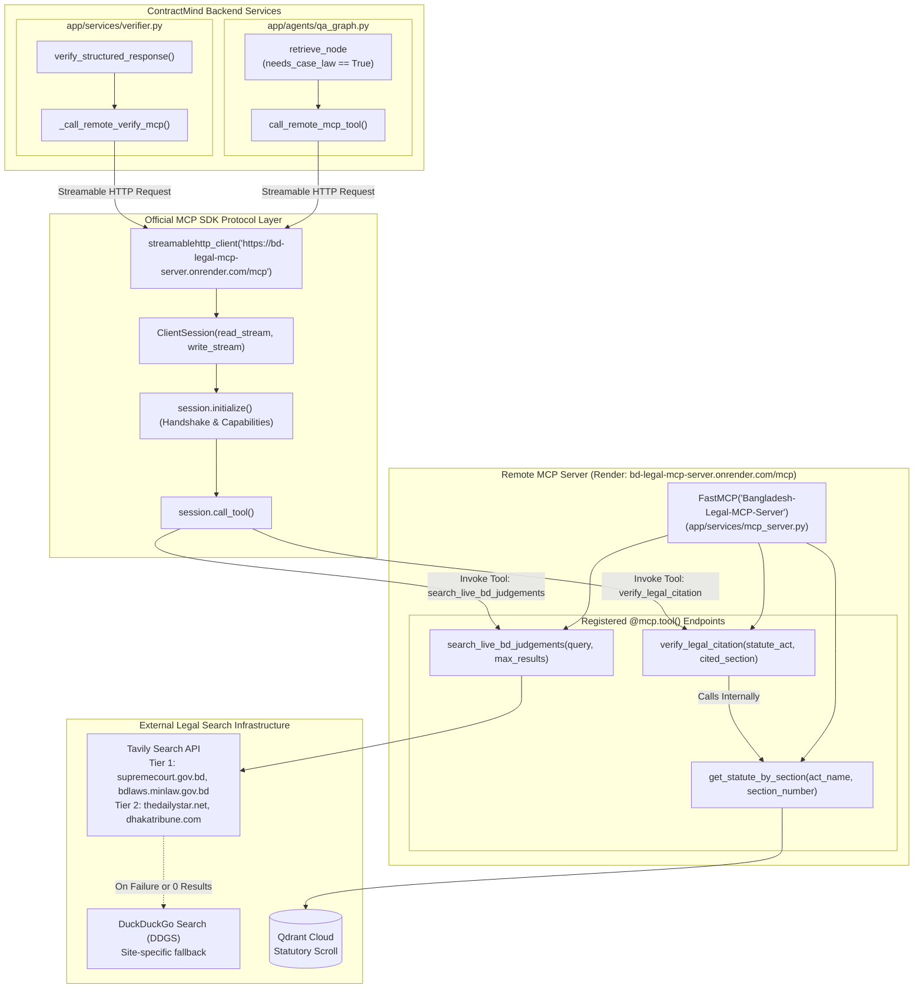
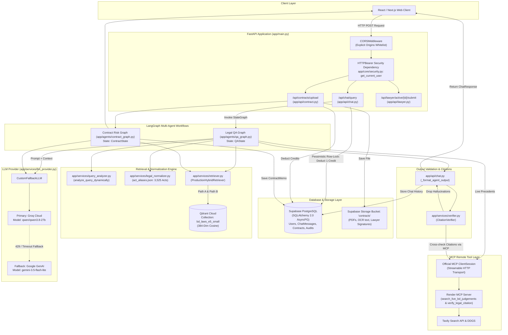
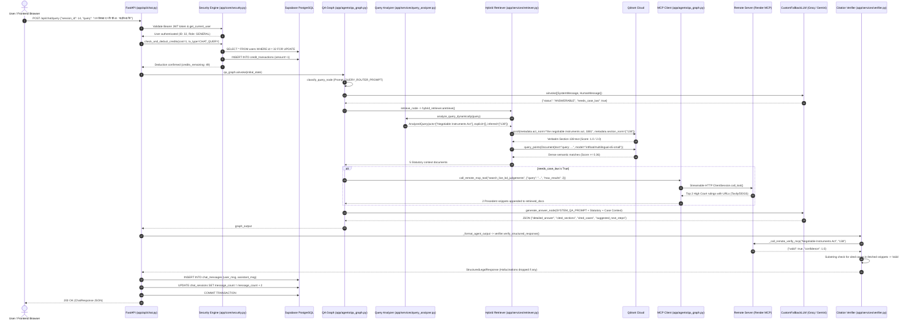

# Architecture Audit & Complete Technical Map: Advotech Copilot

> **System Designation**: Advotech Copilot (ContractMind Backend)  
> **Domain**: Legal AI & Contract Risk Auditing (Bangladesh Statutory & Case Law)  
> **Audit Date**: October 2026  
> **Repository Path**: `c:\Users\tasin\Downloads\test\legal-copilot-backend`  
> **Audit Nature**: Read-Only Architectural Verification, Systems Audit & Dataflow Mapping  

---

## Table of Contents
1. [Executive Summary](#1-executive-summary)
2. [Project Structure Map](#2-project-structure-map)
3. [API and Service Map](#3-api-and-service-map)
4. [RAG Architecture Diagram](#4-rag-architecture-diagram)
5. [MCP Architecture Diagram](#5-mcp-architecture-diagram)
6. [Complete Backend Integration Diagram](#6-complete-backend-integration-diagram)
7. [End-to-End Sequence Diagram](#7-end-to-end-sequence-diagram)
8. [Function Call Chains](#8-function-call-chains)
9. [Integration Status Matrix](#9-integration-status-matrix)
10. [Missing Connections and Bugs](#10-missing-connections-and-bugs)
11. [Complete Request Lifecycle](#11-complete-request-lifecycle)
12. [Recommended Next Steps](#12-recommended-next-steps)

---

## 1. Executive Summary

**Advotech Copilot** (internally designated and registered as **ContractMind**) is an enterprise-grade legal AI and contract auditing backend specifically engineered for the jurisdiction of **Bangladesh statutory and case law**.

The system addresses two primary workflows:
1. **Conversational Legal QA & Precedent Retrieval Engine**: A Retrieval-Augmented Generation (RAG) system grounded in over 43,000 sections of the Bangladesh Code, coupled with real-time judicial precedent retrieval via the **Model Context Protocol (MCP)**.
2. **Contract Risk Audit & Human-in-the-Loop (HITL) Verification Engine**: An automated contract auditing pipeline that ingests documents (PDF, DOCX, scanned images via Vision/Lens OCR), audits them against Bangladesh statutes and internal enterprise playbooks, flags void clauses (e.g., restraint of trade under Section 27 of the Contract Act 1872), and orchestrates lawyer task allocation, review queues, and bKash payout disbursements.

### Core Architectural Mechanics
- **API Framework**: Built on **FastAPI 0.115.0** using an asynchronous application lifecycle (`lifespan` in `app/main.py:43-56`) that initializes the **APScheduler** background runner for SLA and payment monitoring.
- **Relational Persistence**: **Supabase PostgreSQL** accessed via asynchronous SQLAlchemy 2.0 with the `asyncpg` driver. To ensure ACID integrity during financial and quota operations, credit deductions execute under strict row-level pessimistic locking (`SELECT ... FOR UPDATE` in `app/core/security.py:211-220`).
- **AI Agent Orchestration**: Implemented via **LangGraph** (`StateGraph`), separating concerns into a classification router, a dual-path hybrid retrieval node, an MCP case-law client, and a JSON generation node.
- **LLM Strategy**: Implements a primary/fallback architecture in `app/services/llm_provider.py:15-56` using `CustomFallbackLLM`: primary inference runs on **Groq** (`qwen/qwen3.8-27b`), automatically falling back to **Google Gemini** (`gemini-3.5-flash-lite`) upon 429 rate limits, 5xx outages, or timeouts.
- **Vector Search & RAG**: Powered by **Qdrant Cloud** hosting dense 384-dimensional vector embeddings generated using `intfloat/multilingual-e5-small`. Retrieval executes as a hybrid system: **Path A** performs exact statutory section lookups via Qdrant scroll filters against 3,525 canonical act aliases, while **Path B** performs dense semantic search.
- **MCP Protocol & Transport**: Utilizes the official **MCP Python SDK** (`mcp` package). The backend connects to an independent, remote MCP server hosted at `https://bd-legal-mcp-server.onrender.com/mcp` using `streamablehttp_client` and `ClientSession` to execute live judicial search and citation validation.
- **Security & RBAC**: Multi-tenant Role-Based Access Control (RBAC) supporting 5 distinct roles: `GENERAL`, `LAWYER`, `ENTERPRISE_ADMIN`, `ENTERPRISE_MEMBER`, and `ADMIN`.

---

## 2. Project Structure Map

```
legal-copilot-backend/
├── app/
│   ├── main.py                  # Entry point: FastAPI initialization, CORS whitelist, lifespan, router mounting
│   ├── config.py                # Pydantic V2 BaseSettings loading environment configurations from .env
│   ├── agents/                  # LangGraph agent workflows, typed states, and system prompts
│   │   ├── state.py             # QAState, ClauseRisk, ContractState TypedDict definitions
│   │   ├── prompts.py           # SYSTEM_QA_PROMPT, SYSTEM_CONTRACT_RISK_PROMPT, extraction prompts
│   │   ├── nodes.py             # Contract graph execution nodes (statute retrieval & risk audit)
│   │   ├── qa_graph.py          # StateGraph workflow for legal QA (classify -> retrieve -> generate)
│   │   └── contract_graph.py    # StateGraph workflow for contract risk auditing
│   ├── api/                     # REST API routers & endpoint controllers
│   │   ├── auth.py              # User onboarding, email OTP, Google OAuth 2.0, JWT issuance
│   │   ├── admin.py             # Superadmin dashboard, lawyer/enterprise verification, manual credit adjustments
│   │   ├── company.py           # Enterprise tenant management, member approval, playbook management
│   │   ├── chat.py              # Legal chat sessions, credit deductions, QA graph invocation, citation verification
│   │   ├── contract.py          # Contract upload, text/OCR extraction, AI audit, HITL verification lifecycle
│   │   ├── lawyer.py            # Lawyer workspace: review queue, 3-hour offer acceptance, review submission, payouts
│   │   ├── payments.py          # bKash manual payment flow (package top-up, TrxID submission, history)
│   │   └── settings.py          # User settings, profile updates, avatar uploads, password changes
│   ├── core/                    # Core infrastructure: database, security, and pricing
│   │   ├── database.py          # Async SQLAlchemy engine (asyncpg), async_sessionmaker, PgBouncer settings
│   │   ├── security.py          # Password hashing (bcrypt), JWT tokens, RBAC dependencies, row-locked credit deduction
│   │   ├── tier_limits.py       # Session limits, monthly chat quotas, and demo bypass rules
│   │   └── pricing.py           # Single source of truth for credit pricing, BDT values, and lawyer payout splits
│   ├── models/                  # SQLAlchemy ORM declarative models
│   │   ├── __init__.py          # Unified model imports resolving all foreign keys and relations
│   │   ├── user.py              # User, CreditTransaction, WithdrawalRequest models
│   │   ├── chat.py              # ChatSession, ChatMessage models
│   │   ├── lawyer.py            # LawyerProfile model (bar council credentials, ratings, wallet balance)
│   │   ├── memo.py              # Contract, ContractMemo models (AI risk metrics, HITL state machine)
│   │   ├── playbook.py          # Enterprise, CompanyPlaybook, CreditPackage models
│   │   └── audit.py             # Payment and AuditLog models
│   └── services/                # Business logic, search engines, and third-party integrations
│       ├── llm_provider.py      # CustomFallbackLLM (Groq primary -> Gemini fallback)
│       ├── vector_store.py      # QdrantVectorManager client configured for cloud inference (E5-small)
│       ├── retriever.py         # ProductionHybridRetriever (Path A exact lookup + Path B dense search)
│       ├── query_analyzer.py    # Dynamic query analyzer (extracts Acts and sections via LLM / fallback regex)
│       ├── legal_normalizer.py  # Bengali/English digit, section, and Act canonical normalization
│       ├── verifier.py          # CitationVerifier (remote MCP citation verification + context cross-referencing)
│       ├── mcp_server.py        # FastMCP server exposing 3 legal search/verification tools
│       ├── ingestion.py         # PDF, DOCX, and scanned document OCR processor (Google Vision & Lens API)
│       ├── playbook_parser.py   # Corporate playbook policy extractor (LLM rule structuring)
│       ├── lawyer_assignment.py # Weighted lawyer matching algorithm, SLA monitoring, and task reallocation
│       ├── email_service.py     # Gmail API and SMTP email dispatch with demo log fallback
│       └── cron.py              # APScheduler background tasks (15-min and 1-hour cron jobs)
├── data/
│   └── laws/                    # Master Bangladesh statute dataset
│       └── all_bangladesh_laws.json # 43,000+ active statutory sections (63.8 MB)
├── scripts/                     # Operational, data seeding, and re-indexing scripts
│   ├── init_db.py               # Generates tables in PostgreSQL via Base.metadata.create_all
│   ├── reingest_small.py        # Batch ingestion into Qdrant using FastEmbed multilingual-e5-small
│   ├── scrape_laws.py           # Scrapes/extracts laws from HuggingFace dataset (Ashik2380/bdlaws)
│   ├── scrape_judgements.py     # Scrapes judicial notices from supremecourt.gov.bd
│   ├── seed_packages.py         # Seeds default credit packages into the database
│   └── reset_db.py              # Development utility to purge and reinitialize tables
├── tests/                       # Automated test suite
│   ├── conftest.py              # Pytest async fixtures, in-memory SQLite engine, mock user injection
│   ├── test_auth.py             # User registration and login flow unit tests
│   ├── test_chat.py             # Chat session, credit deduction, and mock QA graph tests
│   ├── test_contract.py         # Contract upload and mock risk audit tests
│   └── test_payments.py         # Payment package and verification tests
├── act_aliases.json             # 3,525 Act alias mappings for canonical statute resolution
├── credentials.json             # Google OAuth client secrets (for Gmail API)
├── requirements.txt             # Project Python dependencies
└── pytest.ini                   # Pytest async configuration
```

---

## 3. API and Service Map

| HTTP Method & Path | Router Module | Auth & Permissions | Request Schema | Controller / Service Called | DB Reads / Writes | RAG / MCP / LLM Operations | Response Schema |
|---|---|---|---|---|---|---|---|
| `POST /api/auth/register/email` | `auth.py:205` | Public | `EmailRegisterRequest` | `send_otp_email` | Reads: `User`<br>Writes: `User` (inactive) | None | `RegisterResponse` |
| `POST /api/auth/register/enterprise-admin` | `auth.py:225` | Public | `EnterpriseRegisterRequest` | `send_otp_email` | Reads: `User`, `Enterprise`<br>Writes: `User`, `Enterprise` | None | `RegisterResponse` |
| `POST /api/auth/register/lawyer` | `auth.py:267` | Public | `LawyerRegisterRequest` | `send_otp_email` | Reads: `User`, `LawyerProfile`<br>Writes: `User`, `LawyerProfile` | None | `RegisterResponse` |
| `POST /api/auth/verify-otp` | `auth.py:302` | Public | `VerifyOtpRequest` | `create_access_token` | Reads: `User`<br>Writes: `User` (active, bonus credits) | None | `Token` |
| `POST /api/auth/login` | `auth.py:398` | Public | `LoginRequest` | `verify_password`, `create_access_token` | Reads: `User`<br>Writes: `User.last_login_at` | None | `Token` |
| `POST /api/auth/login/google` | `auth.py:408` | Public | `GoogleLoginRequest` | `id_token.verify_oauth2_token` | Reads: `User`<br>Writes: `User` | None | `Token` |
| `GET /api/auth/me` | `auth.py:489` | Authenticated | None | `get_current_user` | Reads: `User`, `LawyerProfile`, `Enterprise` | None | `UserResponse` |
| `POST /api/chat/sessions` | `chat.py:177` | Authenticated | `CreateSessionRequest` | `get_max_active_sessions` | Reads: `ChatSession`, `Contract`<br>Writes: `ChatSession` | None | `dict` (session info) |
| `GET /api/chat/sessions` | `chat.py:234` | Authenticated | Query Params | Database query | Reads: `ChatSession` | None | `List[dict]` |
| `GET /api/chat/sessions/{id}` | `chat.py:262` | Authenticated (Owner) | Path: `id` | Database query | Reads: `ChatSession`, `ChatMessage` | None | `dict` (full history) |
| `POST /api/chat/query` | `chat.py:324` | Authenticated (Credits check) | `QueryRequest` | `check_and_deduct_credits`, `qa_graph.ainvoke`, `_format_agent_output` | Reads: `ChatSession`, `ChatMessage`, `ContractMemo`<br>Writes: `ChatMessage`, `ChatSession`, `CreditTransaction` | **RAG**: Qdrant hybrid retrieval<br>**MCP**: `search_live_bd_judgements`, `verify_legal_citation`<br>**LLM**: Router, generation & rolling summary | `ChatResponse` |
| `POST /api/contracts/upload` | `contract.py:128` | Authenticated (Credits check) | Multipart Form: `file`, `title` | `extract_text_from_file`, `_upload_to_supabase`, `analyze_contract_risk_async` | Reads: `CompanyPlaybook`<br>Writes: `Contract`, `ContractMemo`, `CreditTransaction` | **RAG**: Statute retrieval (`hybrid_retriever`)<br>**LLM**: Contract risk analysis | `ContractMemoResponse` |
| `POST /api/contracts/{id}/request-verification` | `contract.py:256` | Authenticated (Owner) | Path: `id` | `check_and_deduct_credits`, `generate_initial_offer` | Reads: `Contract`, `ContractMemo`<br>Writes: `ContractMemo`, `CreditTransaction` | None | `RequestVerificationResponse` |
| `GET /api/contracts/history` | `contract.py:326` | Authenticated | Query Params | Database query | Reads: `Contract`, `ContractMemo` | None | `List[dict]` |
| `GET /api/contracts/{id}/download` | `contract.py:390` | Authenticated (Owner) | Path: `id` | Supabase Storage SDK | Reads: `Contract`, `ContractMemo` | None | `dict` (signed download URL) |
| `GET /api/lawyer/queue` | `lawyer.py:69` | Role: `LAWYER` | None | Database query | Reads: `ContractMemo`, `LawyerProfile` | None | `List[dict]` |
| `POST /api/lawyer/queue/{id}/accept` | `lawyer.py:88` | Role: `LAWYER` | Path: `id` | `send_client_lawyer_assigned_email` | Reads: `ContractMemo`<br>Writes: `ContractMemo`, `ChatSession` | None | `dict` |
| `POST /api/lawyer/active/{id}/submit` | `lawyer.py:137` | Role: `LAWYER` | `SubmitReviewRequest` | `send_client_verification_complete_email` | Reads: `ContractMemo`, `LawyerProfile`<br>Writes: `ContractMemo`, `LawyerProfile.wallet_balance` | None | `dict` |
| `POST /api/lawyer/withdraw` | `lawyer.py:253` | Role: `LAWYER` | `WithdrawRequest` | Database creation | Reads: `LawyerProfile`<br>Writes: `WithdrawalRequest`, `LawyerProfile.wallet_balance` | None | `dict` |
| `POST /api/company/playbook/upload` | `company.py:650` | Role: `ENTERPRISE_ADMIN` | Multipart Form: `title`, `file` | `extract_text_from_file`, `parse_playbook_to_rules` | Reads: `CompanyPlaybook`<br>Writes: `CompanyPlaybook`, `AuditLog` | **LLM**: Rule structuring via `get_llm()` | `dict` |
| `POST /api/payments/initiate` | `payments.py:225` | Authenticated | `InitiatePaymentRequest` | Database creation | Reads: `CreditPackage`<br>Writes: `Payment` | None | `dict` (bKash instructions) |
| `POST /api/payments/{id}/submit-trx` | `payments.py:350` | Authenticated (Payer) | `SubmitTrxRequest` | Database update | Reads: `Payment`<br>Writes: `Payment.trx_id` | None | `dict` |
| `POST /api/admin/payments/{id}/approve` | `admin.py:423` | Role: `ADMIN` | Path: `id` | Balance update with row-locking | Reads: `Payment`, `User`, `Enterprise`<br>Writes: `Payment`, `User`, `Enterprise`, `CreditTransaction` | None | `dict` |
| `GET /health` | `main.py:134` | Public | None | Database ping & Qdrant ping | Reads: PostgreSQL `SELECT 1`, Qdrant `get_collection` | None | `JSONResponse` |

---

## 4. RAG Architecture Diagram

```mermaid
flowchart TD
    subgraph INGESTION["Phase A: Data Ingestion & Pre-Indexing"]
        A1["Ashik2380/bdlaws\nHuggingFace Dataset"] -->|scripts/scrape_laws.py| A2["all_bangladesh_laws.json\n(43,000+ Sections)"]
        A2 -->|scripts/reingest_small.py\nFastEmbed TextEmbedding| A3["intfloat/multilingual-e5-small\n(384 Dim Dense Vectors)"]
        A3 -->|Upsert in Batches of 500\nPrefix: 'passage: '| A4[("Qdrant Cloud\nCollection: bd_laws_e5_small")]
    end

    subgraph QUERY["Phase B: RAG Query Lifecycle"]
        B1["User Legal Query"] --> B2["app/api/chat.py\nLanguage Detection & Credit Deduction"]
        B2 --> B3["qa_graph: classify_query_node\n(LLM Query Classifier)"]
        
        B3 -->|If OUT_OF_SCOPE or NEEDS_CLARIFICATION| B4["Immediate Direct Response\n(Bypass Search)"]
        B3 -->|If ANSWERABLE or Explicit Section| B5["qa_graph: retrieve_node"]
        
        B5 --> B6["query_analyzer: analyze_query_dynamically"]
        B6 --> B7{"Query Analysis Output\n- detected_acts\n- explicit_sections\n- inferred_sections\n- optimized_query"}
        
        B7 -->|Path A: Exact Section Lookup| B8["legal_normalizer.resolve_act_robust\n& get_section_variants"]
        B8 -->|Qdrant Scroll Filter\nmetadata.act_norm & section_norm| B9["Exact Statutory Provisions\n(Score = 2.0 / 1.0)"]
        
        B7 -->|Path B: Dense Semantic Search| B10["vector_manager.similarity_search\nPrefix: 'query: ' | Cloud Inference"]
        B10 -->|Cosine Similarity Filter >= 0.36| B11["Semantic Matches\n(Score = Dense Cosine)"]
        
        B5 -->|If needs_case_law is True| B12["MCP Client: streamablehttp_client\ncall_remote_mcp_tool('search_live_bd_judgements')"]
        B12 -->|Remote MCP Server on Render\nTavily API & DDGS Fallback| B13["Live High Court / Supreme Court\nPrecedents (Top 2)"]
        
        B9 & B11 --> B14["hybrid_retriever: Merge & Re-rank\n(+0.2 boost for dual-path hits)"]
        B14 & B13 --> B15["Top 5 Statutory Docs + 2 Precedent Hits"]
        
        B15 --> B16["qa_graph: generate_answer_node\n(Prompt Assembly: Statutes + Case Laws)"]
        B16 -->|If No Context Found| B17["NO_CONTEXT_ANSWER Fallback"]
        B16 -->|Context Available| B18["LLM Provider (Groq / Gemini)\nStrict JSON Generation"]
        
        B18 --> B19["verifier: CitationVerifier\nRemote MCP: verify_legal_citation\nLocal Regex Fallback"]
        B19 --> B20["StructuredLegalResponse\nSaved to PostgreSQL chat_messages"]
    end
```



---

## 5. MCP Architecture Diagram



---

## 6. Complete Backend Integration Diagram



---

## 7. End-to-End Sequence Diagram



---

## 8. Function Call Chains

### Chain 1: Legal Chat Query & Dual RAG + MCP Execution
```
Client HTTP Request: POST /api/chat/query
│
└── app.api.chat.process_chat_query() [app/api/chat.py:325]
    ├── app.core.security.get_current_user() [app/core/security.py:81]
    ├── app.core.security.detect_language() [app/core/security.py:176]
    ├── app.core.security.check_and_deduct_credits() [app/core/security.py:234]
    │   └── app.core.security._lock_user() [app/core/security.py:211] (SELECT FOR UPDATE)
    │
    └── app.agents.qa_graph.qa_graph.ainvoke() [app/agents/qa_graph.py:429]
        │
        ├── [Node 1] app.agents.qa_graph.classify_query_node() [app/agents/qa_graph.py:126]
        │   └── app.services.llm_provider.get_llm().ainvoke() [app/services/llm_provider.py:58]
        │
        ├── [Node 2] app.agents.qa_graph.retrieve_node() [app/agents/qa_graph.py:191]
        │   ├── app.services.retriever.ProductionHybridRetriever.aretrieve() [app/services/retriever.py:223]
        │   │   └── app.services.retriever.ProductionHybridRetriever.retrieve() [app/services/retriever.py:177]
        │   │       ├── app.services.query_analyzer.analyze_query_dynamically() [app/services/query_analyzer.py:116]
        │   │       ├── app.services.retriever._targeted_lookup() [app/services/retriever.py:58]
        │   │       │   ├── app.services.legal_normalizer.resolve_act_robust() [app/services/legal_normalizer.py:65]
        │   │       │   ├── app.services.legal_normalizer.get_section_variants() [app/services/legal_normalizer.py:148]
        │   │       │   └── QdrantClient.scroll() [app/services/retriever.py:91]
        │   │       └── app.services.retriever._dense_semantic_search() [app/services/retriever.py:139]
        │   │           └── app.services.vector_store.QdrantVectorManager.similarity_search() [app/services/vector_store.py:23]
        │   │               └── QdrantClient.query_points() [app/services/vector_store.py:38]
        │   │
        │   └── [MCP Call] app.agents.qa_graph.call_remote_mcp_tool() [app/agents/qa_graph.py:106]
        │       ├── mcp.client.streamable_http.streamablehttp_client()
        │       ├── mcp.ClientSession.initialize()
        │       └── mcp.ClientSession.call_tool("search_live_bd_judgements")
        │
        └── [Node 3] app.agents.qa_graph.generate_answer_node() [app/agents/qa_graph.py:294]
            └── app.services.llm_provider.CustomFallbackLLM.ainvoke() [app/services/llm_provider.py:40]
                ├── Primary: ChatGroq._agenerate()
                └── Fallback: ChatGoogleGenerativeAI._agenerate()

Post-Graph Processing:
└── app.api.chat._format_agent_output() [app/api/chat.py:77]
    ├── app.services.verifier.CitationVerifier.verify_structured_response() [app/services/verifier.py:91]
    │   └── app.services.verifier._call_remote_verify_mcp() [app/services/verifier.py:15]
    │       └── mcp.ClientSession.call_tool("verify_legal_citation")
    └── SQLAlchemy Commit: ChatMessage, ChatSession [app/api/chat.py:466]
```

### Chain 2: Contract Upload, OCR, Playbook & Risk Audit
```
Client HTTP Request: POST /api/contracts/upload
│
└── app.api.contract.upload_and_audit() [app/api/contract.py:128]
    ├── app.core.security.check_and_deduct_credits() [app/core/security.py:234]
    ├── app.api.contract._upload_to_supabase() [app/api/contract.py:102]
    │   └── supabase.storage.from_("contracts").upload()
    ├── app.services.ingestion.extract_text_from_file() [app/services/ingestion.py:185]
    │   ├── pypdf.PdfReader.extract_text()
    │   └── app.services.ingestion.DocumentProcessor.process_pdf_with_ocr() [app/services/ingestion.py:106]
    │       ├── pdf2image.convert_from_path()
    │       ├── Google Cloud Vision: document_text_detection() [app/services/ingestion.py:62]
    │       └── Chrome Lens API OCR fallback [app/services/ingestion.py:78]
    │
    └── app.agents.contract_graph.analyze_contract_risk_async() [app/agents/contract_graph.py:30]
        └── contract_graph.ainvoke()
            ├── [Node 1] app.agents.nodes.retrieve_statutes_node() [app/agents/nodes.py:11]
            │   └── app.services.retriever.hybrid_retriever.retrieve(query_snippet, top_k=8)
            └── [Node 2] app.agents.nodes.analyze_risk_node() [app/agents/nodes.py:31]
                └── app.services.llm_provider.get_llm().invoke()
    ├── app.api.contract._calculate_metrics() [app/api/contract.py:83]
    ├── SQLAlchemy Commit: Contract, ContractMemo [app/api/contract.py:239]
    └── Return ContractMemoResponse
```

---

## 9. Integration Status Matrix

| Component | Exists | Connected | Runtime Verified | Evidence | Status |
|---|---|---|---|---|---|
| **FastAPI Core & Routers** | Yes | Yes | Statically Verified | `app/main.py:97-120` | **Verified** |
| **SQLAlchemy Async DB (asyncpg)** | Yes | Yes | Statically Verified | `app/core/database.py:33-60` | **Verified** |
| **Pessimistic Credit Row-Locks** | Yes | Yes | Statically Verified | `app/core/security.py:211-331` | **Verified** |
| **Qdrant Vector Manager** | Yes | Yes | Blocked by API Key | `app/services/vector_store.py:6-75` | **Partially Verified** |
| **Production Hybrid Retriever** | Yes | Yes | Blocked by Qdrant | `app/services/retriever.py:52-227` | **Partially Verified** |
| **Act Aliases (3,525 Acts)** | Yes | Yes | Statically Verified | `act_aliases.json`, `app/services/legal_normalizer.py:9-15` | **Verified** |
| **Dynamic Query Analyzer** | Yes | Yes | Blocked by LLM | `app/services/query_analyzer.py:116-166` | **Partially Verified** |
| **QA LangGraph Workflow** | Yes | Yes | Mock-tested | `app/agents/qa_graph.py:414-429`, `tests/test_chat.py:21` | **Partially Verified** |
| **Contract Risk Graph** | Yes | Yes | Mock-tested | `app/agents/contract_graph.py:17-51`, `tests/test_contract.py` | **Partially Verified** |
| **Groq / Gemini Fallback LLM** | Yes | Yes | Blocked by API Keys | `app/services/llm_provider.py:15-110` | **Partially Verified** |
| **MCP Client Protocol (Streamable HTTP)** | Yes | Yes | Statically Verified | `app/agents/qa_graph.py:10-11`, `app/services/verifier.py:7-8` | **Verified** |
| **MCP Tool: `search_live_bd_judgements`** | Yes | Yes | Statically Verified | `app/services/mcp_server.py:104`, called in `qa_graph.py:234` | **Verified** |
| **MCP Tool: `verify_legal_citation`** | Yes | Yes | Statically Verified | `app/services/mcp_server.py:248`, called in `verifier.py:26` | **Verified** |
| **MCP Tool: `get_statute_by_section`** | Yes | Internal Server | Statically Verified | `app/services/mcp_server.py:174`, called by `verify_legal_citation` | **Verified** |
| **Citation Verifier** | Yes | Yes | Statically Verified | `app/services/verifier.py:91-174`, called in `chat.py:99` | **Verified** |
| **Supabase Cloud Storage** | Yes | Yes | Blocked by Service Key | `app/api/contract.py:32-41` | **Partially Verified** |
| **Document OCR Engine (Vision & Lens)** | Yes | Yes | Statically Verified | `app/services/ingestion.py:62-149` | **Verified** |
| **Playbook Parser** | Yes | Yes | Statically Verified | `app/services/playbook_parser.py:24-83` | **Verified** |
| **APScheduler Background Cron** | Yes | Yes | Statically Verified | `app/services/cron.py:21-123`, `app/main.py:50` | **Verified** |
| **Email Service (Gmail API/SMTP)** | Yes | Yes | Fallback Verified | `app/services/email_service.py:174-218` | **Verified** |

---

## 10. Missing Connections and Bugs

### Critical Severity

#### 1. Hardcoded Render MCP Server URL in Source Code
- **Evidence**:
  - `app/agents/qa_graph.py:111`:
    ```python
    MCP_URL = "https://bd-legal-mcp-server.onrender.com/mcp"
    ```
  - `app/services/verifier.py:20`:
    ```python
    MCP_URL = "https://bd-legal-mcp-server.onrender.com/mcp"
    ```
- **Why it happens**: Hardcoded string literal within async tool caller functions rather than utilizing `app/config.py` Pydantic `BaseSettings`.
- **User Impact**: If the Render deployment spins down (free tier cold start), changes domain, or needs local staging (`http://localhost:8001/mcp`), the entire live precedent search and citation verification pipeline fails or hangs for up to 60 seconds without environment-level control.
- **Modules Involved**: `app/agents/qa_graph.py`, `app/services/verifier.py`, `app/config.py`.
- **What should be investigated next**: Add `MCP_SERVER_URL: str = Field(default="https://bd-legal-mcp-server.onrender.com/mcp")` into `app/config.py`, and reference `settings.MCP_SERVER_URL` in both modules with explicit HTTP connection timeout configuration.

---

### High Severity

#### 2. Hardcoded Admin Role Bypass Backdoor in Tier Limits
- **Evidence**: `app/core/tier_limits.py:60-63`:
  ```python
  # ✅ HACK: আপনার নির্দিষ্ট ডেমো ইউজারের জন্য আনলিমিটেড সেশন ও মেসেজ লিমিট
  if getattr(user, "email", "") == "mowesin210@backyr.com":
      return "ADMIN"
  ```
- **Why it happens**: Leftover hardcoded shortcut for an internal demo account.
- **User / Security Impact**: Any user registering or logging in with the email address `mowesin210@backyr.com` is granted administrative tier quotas (200,000 active sessions and 200,000 messages per session) without payment and without holding the `ADMIN` role in the database.
- **Modules Involved**: `app/core/tier_limits.py`.
- **What should be investigated next**: Remove lines 60-63 entirely. Tier assignment must be strictly derived from database state (`user.role` and `user.subscription_tier`).

#### 3. Broken Python Host Interpreter Environment
- **Evidence**: CLI executions against `python` or `.\venv\Scripts\pytest.exe` return:
  ```
  Failed to find real location of C:\Users\tasin\AppData\Local\Programs\Python\Python314\python.exe
  ```
- **Why it happens**: The local virtual environment located at `c:\Users\tasin\Downloads\test\legal-copilot-backend\venv` was initialized with a Python 3.14 shim or path that has moved or is missing from Windows LocalAppData.
- **User / Operational Impact**: Local command line test execution, data ingestion scripts, and administrative maintenance commands fail to execute directly from standard shells without manual virtual environment recreation.
- **Modules Involved**: Root environment / `venv`.
- **What should be investigated next**: Recreate the local virtual environment (`python -m venv venv`) using a verified Python 3.11/3.12 binary and reinstall dependencies from `requirements.txt`.

---

### Medium Severity

#### 4. Automated Tests Fully Mock AI and Vector Store Layers
- **Evidence**: `tests/test_chat.py:21-28` and `tests/test_contract.py:12-15`:
  ```python
  with patch("app.api.chat.qa_graph.ainvoke", new_callable=AsyncMock) as mock_qa_graph:
  ```
- **Why it happens**: Designed as fast unit tests to avoid network calls and API key dependencies in CI/CD.
- **User Impact**: Regressions in Qdrant scroll schemas, `intfloat/multilingual-e5-small` vector dimensions, FastMCP streamable HTTP handshakes, or Tavily API responses are never detected by the existing automated test suite.
- **Modules Involved**: `tests/test_chat.py`, `tests/test_contract.py`.
- **What should be investigated next**: Add an integration test file (`tests/test_rag_mcp_integration.py`) that tests `hybrid_retriever` and `call_remote_mcp_tool` against mock vector points and mock MCP streams.

---

### Low / Informational Severity

#### 5. Redundant / Superseded Scripts
- **Evidence**:
  - `scripts/reingest.py` vs `scripts/reingest_small.py`: `reingest.py` uses the older BGE-m3 / large model embeddings, while `reingest_small.py` is the active ingestion script for `intfloat/multilingual-e5-small`.
  - `scripts/seed_vector_db.py` contains redundant LLM layman tagging logic that is not part of the active production pipeline.
- **Why it happens**: Scripts preserved during experimentation and model benchmarking.
- **User Impact**: None in production; potential confusion for operators running manual re-indexing.
- **Modules Involved**: `scripts/reingest.py`, `scripts/seed_vector_db.py`.
- **What should be investigated next**: Archive deprecated scripts into an `archive/` or `deprecated/` subfolder.

---

## 11. Complete Request Lifecycle

### The Journey of a Legal Question

#### Step 1: Ingress & Authentication
1. The frontend client sends an HTTP `POST` request to `/api/chat/query`:
   ```json
   {
     "session_id": 14,
     "query": "কোম্পানি ৩ মাসের নোটিশ না দিয়ে চাকরি থেকে বরখাস্ত করলে ক্ষতিপূরণ কীভাবে পাব এবং এ সংক্রান্ত সাম্প্রতিক রায় কী?"
   }
   ```
2. Request passes through `CORSMiddleware` in `app/main.py:77-90`, which validates the `Origin` header against explicit origins (`advotech-copilot.vercel.app`, `localhost:3000`, etc.).
3. `get_current_user` dependency in `app/core/security.py:81` decodes the Bearer JWT, validates signature with `SECRET_KEY`, queries the `users` table, and verifies `is_active=True`.

#### Step 2: Session & Credit Verification
4. In `app/api/chat.py:330-344`, the endpoint retrieves `ChatSession` where `id == 14` and `user_id == current_user.id`.
5. It checks that `is_closed == False` and `message_count < session_limit`.
6. Language detection runs via `detect_language(query)` in `app/core/security.py:176`, returning `"bn"`.
7. `check_and_deduct_credits` in `app/core/security.py:234` acquires a pessimistic row-lock on PostgreSQL (`SELECT * FROM users WHERE id = :id FOR UPDATE`), decrements `credit_balance` by 1, and creates an audit record in `credit_transactions` of type `CHAT_QUERY`.

#### Step 3: LangGraph Classification Node (`classify_query_node`)
8. In `app/agents/qa_graph.py:126`, `classify_query_node` checks for explicit statutory sections.
9. If no explicit section exists, `CustomFallbackLLM` is invoked with `QUERY_ROUTER_PROMPT`.
10. The LLM classifies the query as `"ANSWERABLE"` and sets `"needs_case_law": true` because the user explicitly requested recent judicial precedents ("সাম্প্রতিক রায়").
11. The conditional edge `route_after_classification` routes execution to `retrieve`.

#### Step 4: Hybrid RAG & Remote MCP Retrieval (`retrieve_node`)
12. In `app/agents/qa_graph.py:191`, `hybrid_retriever.aretrieve()` executes:
    - **Query Analysis**: `app/services/query_analyzer.py:116` extracts detected Acts (`["Labour Act"]`) and inferred sections (`["26", "27"]`).
    - **Path A (Targeted Statutory Scroll)**: `app/services/legal_normalizer.py:65` resolves "Labour Act" against `act_aliases.json` to `"Bangladesh Labour Act, 2006"`. Qdrant's `scroll` method queries points matching `metadata.act_norm` and `metadata.section_norm in ["26", "27"]`, assigning a score of `2.0`.
    - **Path B (Dense Semantic Search)**: Appends `"query: "` prefix and queries Qdrant Cloud via `query_points` with server-side inference on `intfloat/multilingual-e5-small`. Filters results where cosine score >= `0.36`.
    - **Merge & Re-ranking**: Merges hits, applies a `+0.2` multi-path bonus, and yields the top 5 statutory sections.
13. **Live Judicial Search via Remote MCP**:
    - Because `needs_case_law` is True, `call_remote_mcp_tool` in `app/agents/qa_graph.py:106` opens an async HTTP stream via `streamablehttp_client` to `https://bd-legal-mcp-server.onrender.com/mcp`.
    - The client initializes the MCP session and calls `search_live_bd_judgements(query="...", max_results=2)`.
    - The MCP server queries the Tavily API restricted to Tier 1 (`supremecourt.gov.bd`) and Tier 2 (`thedailystar.net`) domains, returning 2 verified rulings with reference URLs.
    - These are appended to `retrieved_docs` in `QAState` with `source_type="precedent"`.

#### Step 5: Answer Synthesis Node (`generate_answer_node`)
14. In `app/agents/qa_graph.py:294`, statutory texts are truncated to 1,500 characters and precedent snippets to 800 characters to respect Groq token-per-minute limits.
15. Prompt is assembled combining `SYSTEM_QA_PROMPT`, recent 3 chat messages, `VERIFIED_STATUTORY_CONTEXT`, and `VERIFIED_CASE_CONTEXT`.
16. `CustomFallbackLLM` invokes Groq Cloud (`qwen/qwen3.8-27b`). If Groq encounters rate limits or errors, it falls back to Gemini (`gemini-3.5-flash-lite`).
17. LLM returns a strict JSON object containing `detailed_answer`, `cited_sections`, `cited_cases`, and `suggested_next_steps`.

#### Step 6: Post-Processing & Citation Verification
18. In `app/api/chat.py:77`, `_format_agent_output` triggers `verifier.verify_structured_response`.
19. `verifier.py:15` initiates a remote MCP call to `verify_legal_citation` on `bd-legal-mcp-server.onrender.com/mcp` to confirm the cited sections actually exist in the Bangladesh Code. If remote MCP is unreachable, it falls back to word-boundary regex matching against the retrieved context. Any unverified section is dropped from `cited_sections`.
20. Case citations are validated via substring presence or URL validation.

#### Step 7: Persistence & API Response
21. The user query and verified AI response are saved to `chat_messages` in PostgreSQL.
22. `ChatSession.message_count` increments by 2, and `auto_close_at` is extended by 7 days.
23. If `message_count >= 10`, `_generate_rolling_summary` summarizes the discussion and updates `chat_sessions.rolling_summary`.
24. Database transaction commits.
25. Client receives HTTP 200 with the payload conforming to `ChatResponse`.

---

## 12. Recommended Next Steps

### A. Immediate Defect Rectifications

1. **Move MCP Server URL to Environment Configuration**:
   - In `app/config.py`, declare:
     ```python
     MCP_SERVER_URL: str = os.getenv("MCP_SERVER_URL", "https://bd-legal-mcp-server.onrender.com/mcp")
     ```
   - Replace the hardcoded strings in `app/agents/qa_graph.py:111` and `app/services/verifier.py:20` with `settings.MCP_SERVER_URL`.

2. **Remove Hardcoded Email Backdoor**:
   - In `app/core/tier_limits.py:60-63`, delete the conditional check for `mowesin210@backyr.com` so all tier allocations strictly respect database role and subscription tier values.

3. **Rebuild Host Virtual Environment**:
   - Recreate the Python virtual environment on the Windows host using a clean Python 3.11/3.12 interpreter to resolve the broken `python.exe` shim pointer and allow automated test suites to run locally.

### B. Architectural Enhancements

1. **Introduce a Re-entrant Tool Loop with Iteration Guardrails**:
   - Currently, `qa_graph.py` executes a fixed single-pass retrieval. Transition to LangGraph tool nodes (`bind_tools`) allowing the LLM to autonomously decide when to request additional statutory sections or live precedent queries, guarded by a maximum iteration cap (`max_iterations = 3`).

2. **Add MCP Stream Connection Pooling**:
   - Currently, each call to `call_remote_mcp_tool` and `_call_remote_verify_mcp` opens and closes a new `streamablehttp_client` connection and performs a full MCP initialize handshake. Implement a long-lived async MCP client session lifecycle attached to FastAPI lifespan to eliminate handshake overhead (saving 400-800ms per query).

3. **Implement Integration Tests with Mock MCP Transport**:
   - Write integration tests in `tests/` that mock the streamable HTTP transport rather than patching out `qa_graph.ainvoke` entirely, ensuring parsing and verification logic are continuously tested.
