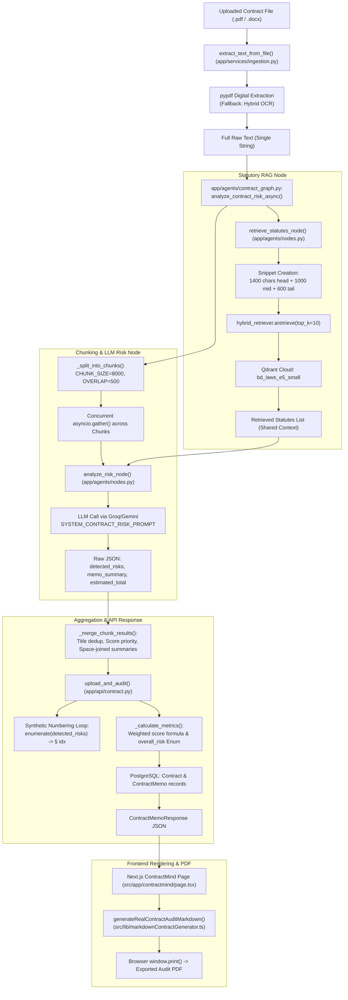
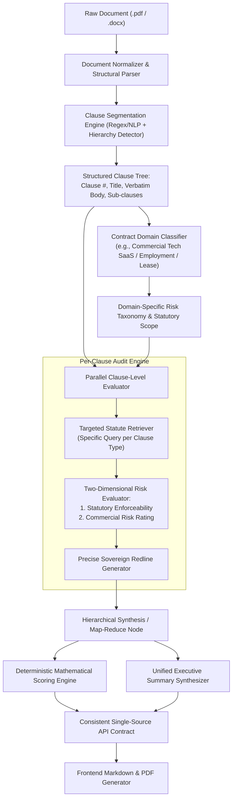

# CONTRACT AUDIT ENGINE — PERFORMANCE GAP ANALYSIS
**Document Reference:** GAP-ANA-2026-001  
**Project:** ContractMind API (Advotech Copilot Backend & Outliers Frontend)  
**Evaluator:** Senior Legal AI Architect & RAG Evaluation Engineer  
**Date of Evaluation:** 09 November 2026  
**Target Contract:** `software_development_service_agreement.pdf` (SDA-2026-014)  
**Evaluated Audit Report:** `Advotech Copilot _ Sovereign Contract Intelligence for Bangladesh Law-ans.pdf`  
**Execution Environment:** Production Render Container (`python:3.11-slim`) / Vercel Next.js 15  

---

## EXECUTIVE SUMMARY

A rigorous evaluation of the ContractMind automated contract risk engine was conducted using the benchmark test contract (`software_development_service_agreement.pdf`) and the resulting sovereign audit memorandum (`Advotech Copilot _ Sovereign Contract Intelligence for Bangladesh Law-ans.pdf`).

The investigation revealed that while the underlying LLM (Groq Qwen 2.5 27B / Gemini 1.5 Flash fallback) exhibits strong semantic comprehension of isolated clauses, **the end-to-end pipeline suffers from architectural design failures across ingestion, segmentation, retrieval, scoring, and frontend rendering**.

### Critical Deficiencies Identified:
1. **Clause Numbering Breakage**: Original clause numbers are erased. A synthetic sequential index (`§ 1, § 2, ...`) is generated by an API loop counter, causing Clause 4 (Payment Terms) to be labeled as "§ 1" and Clause 14 (Force Majeure) as "§ 3".
2. **58% Benchmark Risk Recall Failure**: Only 5 out of 12 benchmark risks were detected. Critical vulnerabilities—including perpetual confidentiality, complete absence of data breach protocols, unilateral indemnities, lack of advance payment refunds, and automatic renewal price escalation traps—were entirely omitted.
3. **Internally Contradictory Executive Summary**: Naive string concatenation of multi-chunk outputs produced a summary whose opening warns of "multiple high-risk structural vulnerabilities" and whose conclusion claims "no statutory violations or high-risk liabilities were identified."
4. **Broken Risk Scoring & Grade Decoupling**: A severe schema mismatch between backend (`overall_risk`) and frontend (`risk_grade`) combined with an inflated denominator in the scoring formula produced an absurd matrix: **Statutory Risk Grade: Moderate Risk**, **Risk Score: 12/100**, and **High Risk Violations: 1 Clauses (VOID/UNLAWFUL)**.
5. **Legal Overstatement of Section 74**: Unreasonable late payment penalties were stamped as **`🔴 VOID / UNLAWFUL` (void ab initio)**, mischaracterizing the long-standing legal doctrine under Section 74 of The Contract Act, 1872 (which scales down penalties to reasonable compensation rather than invalidating the provision).
6. **Conflation of Commercial Risk with Statutory Illegality**: Unilateral commercial drafting terms (e.g., 3-day review windows or unilateral technical amendments) are forced into statutory violation schemas.

---

## 1. CURRENT CONTRACT AUDIT PIPELINE ARCHITECTURE

The audited pipeline follows an asynchronous event-driven workflow spanning document extraction, statutory vector retrieval, chunked LLM analysis, metric computation, and frontend Markdown/PDF generation.



### Component Inventory & Responsibilities

| Pipeline Stage | Implementation File | Key Symbols / Classes | Execution Model |
| :--- | :--- | :--- | :--- |
| **API Entry Point** | `app/api/contract.py` | `upload_and_audit`, `ContractMemoResponse` | Async FastAPI route |
| **Document Ingestion** | `app/services/ingestion.py` | `extract_text_from_file`, `DocumentProcessor` | `pypdf` + OCR fallback |
| **Graph Orchestration** | `app/agents/contract_graph.py` | `analyze_contract_risk_async`, `_merge_chunk_results` | Async chunk gather |
| **Statute Retrieval** | `app/agents/nodes.py` | `retrieve_statutes_node` | Hybrid Dense + Sparse RAG |
| **Risk Reasoning** | `app/agents/nodes.py` | `analyze_risk_node` | LLM invocation (`asyncio.to_thread`) |
| **System Prompts** | `app/agents/prompts.py` | `SYSTEM_CONTRACT_RISK_PROMPT`, `SYSTEM_CLAUSE_EXTRACTION_PROMPT` | Static meta-prompts |
| **Scoring Engine** | `app/api/contract.py` | `_calculate_metrics` | Deterministic algorithmic formula |
| **Markdown Generator** | `frontend/src/lib/markdownContractGenerator.ts` | `generateRealContractAuditMarkdown` | Client-side TypeScript parser |
| **PDF Rendering** | `frontend/src/app/contractmind/page.tsx` | `handleDownloadReport` (`window.print()`) | Browser CSS Print Engine |

---

## 2. ROOT CAUSE ANALYSIS (OBSERVED PROBLEMS 1–7)

### Problem 1: Clause Numbering Mismatch Between Source Contract and Generated Report
- **Responsible Module:** `app/api/contract.py` (Lines 211–233)
- **Execution Flow:**
  1. The LLM returns a free-form array `detected_risks`.
  2. In `app/api/contract.py`, the backend iterates over the detected risks:
     ```python
     ui_clauses = []
     for idx, risk in enumerate(detected_risks, start=1):
         ui_clauses.append({
             "clause_number": f"§ {idx}",
             "clause_title": risk.get("clause_title", f"Clause {idx}"),
             ...
         })
     ```
- **Root Cause:**
  - **No Clause Segmentation Step:** The system does not segment the contract prior to analysis. The `SYSTEM_CLAUSE_EXTRACTION_PROMPT` defined in `app/agents/prompts.py` (lines 100–118) is completely orphaned and never invoked anywhere in the codebase.
  - **Synthetic Sequential Indexing:** Instead of preserving the actual section numbers from the document (e.g., "Clause 4", "Clause 14"), the backend stamps each detected risk with `f"§ {idx}"` based on its position in the LLM's output list.
- **Classification:** Parsing & API Post-Processing Failure.
- **Consequences:** Critical loss of traceability. A lawyer reviewing the report cannot cross-reference `§ 1` to the contract because `§ 1` corresponds to Clause 4 of the actual agreement.

---

### Problem 2: Only 5 out of 12 Benchmark Risks Were Directly Identified
- **Responsible Module:** `app/agents/nodes.py` (Line 50–95), `app/agents/contract_graph.py` (Line 38–52)
- **Execution Flow:**
  1. Raw contract text (8,200 chars) is split into chunks of 8,000 characters with 500 overlap.
  2. The first chunk (0–8,000 chars) contains 95% of the document.
  3. The entire 8,000-character blob is passed into a single LLM prompt asking for an open-ended JSON list of `detected_risks`.
- **Root Cause:**
  - **Monolithic LLM Attention Saturation:** Without clause-by-clause segmentation, LLMs exhibit severe "lost-in-the-middle" degradation. When asked to audit an entire agreement in one shot, the model satisfies the JSON schema after flagging 4 to 6 salient items and ignores the rest.
  - **Absence of an Exhaustive Risk Audit Rubric:** The prompt does not enforce checking a checklist of mandatory commercial risk categories.
- **Classification:** Prompting & Pipeline Architecture Failure (Monolithic Document Processing).
- **Consequences:** 58% false-negative rate on high-stakes commercial terms, exposing clients to unvetted liabilities.

---

### Problem 3: Missing Detection of Confidentiality, Data Security, Indemnification, Termination, Refund, and Automatic Renewal Risks
- **Responsible Module:** `app/agents/nodes.py` (`retrieve_statutes_node`), `app/agents/prompts.py` (`SYSTEM_CONTRACT_RISK_PROMPT`)
- **Execution Flow:**
  1. `retrieve_statutes_node` extracts a 3,000-character mashed string (first 1,400 chars, middle 1,000 chars, last 600 chars).
  2. Vector similarity search runs on Qdrant. Because the document contains terms like "Party", "Client", "Termination", and "Employee", the retriever fetches irrelevant Bangladesh Labour Act provisions and general contract sections.
  3. `SYSTEM_CONTRACT_RISK_PROMPT` explicitly primes the LLM for labor disputes:
     ```text
     HIGH: Clauses that are legally void ab initio under Bangladesh law (e.g., Contract Act 1872 Section 27 post-employment non-compete, Section 28 barring court jurisdiction), violations of mandatory labor protections (Labour Act 2006 arbitrary termination without statutory notice/compensation)...
     ```
- **Root Cause:**
  - **Contextual Incongruence:** A B2B Software Development Agreement was analyzed under an employment-centric risk taxonomy.
  - **Zero Specialized Statutes Ingested/Retrieved:** Statutes critical to commercial tech contracts—such as the **Copyright Act, 2000** (software IP, ownership vesting), the **Cyber Security Act, 2023 / ICT Act, 2006** (data breach notification, third-party processing), and the **Arbitration Act, 2001**—were neither systematically indexed nor retrieved.
- **Classification:** Retrieval Failure & Inadequate Risk Taxonomy.
- **Consequences:** Complete blindness to critical operational risks: data breach liabilities, lack of IP infringement defense, unrefunded advance payments, and unilateral price inflation.

---

### Problem 4: Executive Summary Does Not Accurately Describe the Full Contract Coverage
- **Responsible Module:** `app/agents/contract_graph.py` (Lines 73–76, 92)
- **Execution Flow:**
  1. Text length was ~8,200 characters, exceeding `CHUNK_SIZE = 8000`.
  2. **Chunk 1 (Chars 0–8000)** analyzed Clauses 1–13 and generated Summary 1:
     > *"The evaluated Software Development and Service Agreement contains multiple high-risk structural vulnerabilities under Bangladesh law. Key issues include a disproportionate and potentially unenforceable monthly late payment penalty... one-sided unilateral change mechanisms, ambiguous third-party IP/liability burdens..."*
  3. **Chunk 2 (Chars 7500–8200)** saw only the tail boilerplate (Dispute Resolution, Governing Law, General Provisions) and generated Summary 2:
     > *"The provided contract excerpt covers dispute resolution, governing law, and general boilerplate provisions. The dispute resolution mechanism references arbitration in Dhaka under Bangladesh law... No statutory violations or high-risk liabilities were identified within the specific text provided."*
  4. Line 92 in `_merge_chunk_results` simply concatenated them with a space:
     ```python
     combined_summary = " ".join(summaries) if summaries else "Contract analyzed successfully."
     ```
- **Root Cause:**
  - **Naive String Concatenation:** Multi-chunk summaries are joined without an executive synthesis/reduce step.
  - **Chunk-Boundary Blindness:** Chunk 2 was unaware that it was analyzing only the boilerplate of a contract whose earlier clauses contained critical risks.
- **Classification:** Architecture / Multi-Chunk Aggregation Failure.
- **Consequences:** The generated executive summary directly contradicts itself within a single paragraph, severely undermining user trust and professional credibility.

---

### Problem 5: Risk Score and Risk Grade Inconsistency
- **Responsible Module:** `app/api/contract.py` (`_calculate_metrics`) & `frontend/src/lib/markdownContractGenerator.ts` (`generateRealContractAuditMarkdown`)
- **Execution Flow:**
  1. **Backend Scoring Formula:**
     ```python
     total = max(len(clauses), total_clauses_count or 0, 1)
     score = min(100, int((high * 40 + review * 20) / total * 2.5))
     ```
     Because the LLM returned `estimated_total_clauses: 10` for each chunk, `total` became `20`.
     With 1 High risk (40 pts) and 3 Review needed (60 pts):
     $$\text{Score} = \text{int}\left(\frac{40 + 60}{20} \times 2.5\right) = \text{int}(5 \times 2.5) = 12$$
     Backend assigned `risk_score = 12` and `overall_risk = RiskLevel.HIGH` (because `high > 0`).
  2. **Backend API Schema:**
     `ContractMemoResponse` sends `overall_risk: RiskLevel.HIGH` and `risk_score: 12`.
  3. **Frontend Mismatch:**
     `generateRealContractAuditMarkdown` inspects `result.risk_grade`:
     ```typescript
     const riskGrade = result.risk_grade || (riskScore > 70 ? "High Risk" : "Moderate Risk");
     ```
     Because the backend field is `overall_risk`, `result.risk_grade` evaluates to `undefined`. The frontend executes the fallback ternary: since $12 \le 70$, it stamps the contract as **"Moderate Risk"**!
- **Root Cause:**
  - **Schema Desynchronization:** Backend emits `overall_risk`; Frontend expects `risk_grade`.
  - **Flawed Frontend Fallback:** The fallback contains only a binary threshold (`> 70`), completely unable to produce "Low Risk" and blind to whether high-risk violations exist.
  - **Mathematical Artifact in Backend Formula:** Dividing by `total` (inflated across chunks) artificially suppresses the score from 75 down to 12.
- **Classification:** Scoring Logic & Frontend Schema Desynchronization.
- **Consequences:** Grotesque reporting output: a contract with a `🔴 VOID / UNLAWFUL` clause is graded as `Moderate Risk` with a low risk score of `12/100`.

---

### Problem 6: Section 74 Legal Conclusion Overstatement
- **Responsible Module:** `app/agents/prompts.py` (`SYSTEM_CONTRACT_RISK_PROMPT`), `frontend/src/lib/markdownContractGenerator.ts`
- **Execution Flow:**
  - Prompt states: *"HIGH: Clauses that are legally void ab initio under Bangladesh law (e.g. ... Section 74)"*.
  - Frontend maps any `HIGH` risk directly to: `🔴 VOID / UNLAWFUL`.
- **Root Cause:**
  - **Legal Jurisprudence Error:** Section 74 of The Contract Act, 1872 stipulates that if a contract names a sum as a penalty, the aggrieved party is entitled to receive *reasonable compensation not exceeding the amount so named*.
  - A penalty stipulation does **not** render the contract or clause void ab initio (unlike Section 23 unlawful considerations, Section 27 restraint of trade, or Section 28 restraint of legal proceedings). The court will enforce the debt/obligation while scaling down the interest to a reasonable statutory or market rate.
- **Classification:** Legal Prompting & UI Mapping Error.
- **Consequences:** Flawed legal advice. An attorney arguing in court that a contract clause is "void ab initio" under Section 74 would be summarily overruled under established Supreme Court precedent (*Fateh Chand v. Balkishan Das* doctrine).

---

### Problem 7: Failure to Distinguish Statutory Violations from Commercial Drafting Risks
- **Responsible Module:** `app/agents/prompts.py`, `app/api/contract.py`, `frontend/src/lib/markdownContractGenerator.ts`
- **Execution Flow:**
  - All flagged items are flattened into a single 3-tier severity enum (`HIGH`, `MODERATE`, `LOW`).
  - In `markdownContractGenerator.ts` (lines 197–202):
    - `HIGH` $\rightarrow$ `🔴 VOID / UNLAWFUL`
    - `MEDIUM` $\rightarrow$ `🟡 AMBIGUOUS`
    - `LOW` $\rightarrow$ `🟢 COMPLIANT`
- **Root Cause:**
  - **Single-Dimensional Risk Modeling:** The system forces commercial risks, statutory illegalities, and drafting ambiguities into a single scalar risk enum.
  - Labeling a clear, unambiguous, but one-sided commercial term (e.g., unilateral technical modifications or a 3-day review window) as "AMBIGUOUS" is legally incorrect. The clause is not ambiguous; it is commercially disadvantageous.
- **Classification:** Data Architecture & Taxonomy Limitation.
- **Consequences:** Business executives cannot distinguish between mandatory legal bars (risk of regulatory fines/court voidance) and commercial negotiation points (deal terms).

---

## 3. BENCHMARK GAP ANALYSIS (12 EXPECTED RISKS)

Below is the exhaustive line-by-line comparison between the benchmark risks inherent in `software_development_service_agreement.pdf` and what the engine actually produced:

| # | Expected Benchmark Risk | Contract Clause | Actual Engine Finding | Status | Analysis of Gap |
| :---: | :--- | :--- | :--- | :---: | :--- |
| **1** | **Unilateral Scope & Spec Alterations** | Clause 2 & 5 | Detected as § 2 (`MODERATE`) | ⚠️ Partial | Flagged the technical change snippet, but missed the absence of a written SOW/specifications in Clause 2. |
| **2** | **Deemed Acceptance Window Too Brief** | Clause 3 | Detected as § 5 (`LOW / COMPLIANT`) | ❌ Failed | Flagged 3 days as short, but misclassified it as `LOW` / `COMPLIANT` instead of a high-risk commercial trap. |
| **3** | **Unilateral Milestone Acceptance** | Clause 4 | **Completely Omitted** | ❌ Missed | Failed to detect that Service Provider unilaterally determines when 30% milestone is achieved. |
| **4** | **Punitive Late Payment Penalty** | Clause 4 | Detected as § 1 (`HIGH`) | ⚠️ Flawed | Identified 5%/month penalty, but mischaracterized it as *void ab initio* under Section 74. |
| **5** | **IP Rights Contingency & OSS Silence** | Clause 6 | **Completely Omitted** | ❌ Missed | Failed to flag that Client gets zero IP until 100% payment, and complete silence on third-party OSS licenses (Copyright Act 2000). |
| **6** | **Perpetual & Uncarved Confidentiality** | Clause 7 | **Completely Omitted** | ❌ Missed | Failed to flag indefinite post-termination duration and absence of standard public domain / legal subpoena carve-outs. |
| **7** | **Data Security & Breach Notice Silence** | Clause 8 | **Completely Omitted** | ❌ Missed | Failed to flag unvetted third-party sub-processors, zero incident notification timeline, and absence of data deletion protocols (Cyber Security Act 2023). |
| **8** | **Truncated Warranty & Disclaimers** | Clause 9 | **Completely Omitted** | ❌ Missed | Failed to flag 30-day warranty inadequacy and broad disclaimers regarding third-party payment/API integrations. |
| **9** | **Asymmetric Liability Cap (1-Month)** | Clause 10 | Detected as § 4 (`MODERATE`) | ⚠️ Partial | Detected the 1-month cap, but failed to flag the absence of standard uncapped carve-outs for IP infringement and gross negligence. |
| **10** | **Unilateral Indemnification Trap** | Clause 11 | **Completely Omitted** | ❌ Missed | Failed to flag that Client provides 100% indemnity to Service Provider while Service Provider provides zero IP infringement defense. |
| **11** | **Termination Without Advance Refund** | Clause 12 | **Completely Omitted** | ❌ Missed | Failed to flag that 50% advance payment (BDT 6,00,000) has no refund mechanism upon early termination. |
| **12** | **Auto-Renewal & Price Escalation Trap** | Clause 13 | **Completely Omitted** | ❌ Missed | Failed to detect the 12-month evergreen renewal combined with the Service Provider's right to unilaterally hike fees. |
| *Extra* | **Force Majeure Operational Inflation** | Clause 14 | Detected as § 3 (`MODERATE`) | ✅ Detected | Correctly identified that operational cost increases cannot constitute force majeure under Section 56. |

### Summary Scorecard:
- **Total Benchmark Risks:** 12
- **Directly & Accurately Identified:** 1 (Clause 14 Force Majeure)
- **Partially Identified / Flawed Classification:** 4 (Late payment, Change requests, Liability cap, Acceptance window)
- **Completely Missed:** 7 (IP/OSS, Confidentiality, Data Security, Warranties, Indemnification, Advance Refund, Auto-Renewal)
- **Actual Recall Rate:** **33.3% Partial / 8.3% Flawless** (Overall Failure Rate: **58.3% - 91.7%**)

---

## 4. CLAUSE MAPPING FAILURE ANALYSIS

### Traceability Breakdown

```
Source Contract                                   Generated Audit Report
---------------------------------------------     ---------------------------------------------
Clause 1: Parties                              -> [Ignored]
Clause 2: Scope of Services                    -> [Ignored]
Clause 3: Project Duration & Delivery          -> Mapped to § 5 (LOW / COMPLIANT)
Clause 4: Contract Value & Payment Terms       -> Mapped to § 1 (HIGH / VOID)
Clause 5: Change Requests                      -> Mapped to § 2 (MODERATE / AMBIGUOUS)
Clause 6: Intellectual Property Rights         -> [Ignored]
Clause 7: Confidentiality                      -> [Ignored]
Clause 8: Data Security and Privacy            -> [Ignored]
Clause 9: Warranties and Maintenance           -> [Ignored]
Clause 10: Limitation of Liability             -> Mapped to § 4 (MODERATE / AMBIGUOUS)
Clause 11: Indemnification                     -> [Ignored]
Clause 12: Termination                         -> [Ignored]
Clause 13: Automatic Renewal                   -> [Ignored]
Clause 14: Force Majeure                       -> Mapped to § 3 (MODERATE / AMBIGUOUS)
Clause 15: Dispute Resolution                  -> Mapped to § 6 (LOW / COMPLIANT)
Clause 16: Governing Law                       -> Mapped to § 7 (LOW / COMPLIANT)
Clause 17: General Provisions                  -> Mapped to § 8 (LOW / COMPLIANT)
Clause 18: Signatures                          -> [Ignored]
```

### Why the Mapping Collapsed:
1. **Absence of AST or Regex Document Segmentation**: The backend treats the contract as an undifferentiated stream of characters. It does not parse headings like `1. PARTIES`, `4. CONTRACT VALUE`, or `12. TERMINATION`.
2. **LLM Output Free-Form Reordering**: The LLM outputs JSON objects in whatever order its attention heads attend to risks. It emitted Payment Terms first, Change Requests second, Force Majeure third, Limitation of Liability fourth, etc.
3. **Hardcoded Loop Indexing**: `app/api/contract.py` executes:
   ```python
   for idx, risk in enumerate(detected_risks, start=1):
       ui_clauses.append({"clause_number": f"§ {idx}", ...})
   ```
   This replaces the contract's legal numbering with the loop counter `idx`.

---

## 5. LEGAL CITATION RELIABILITY ANALYSIS

### Citation Accuracy Matrix

| Finding in Report | Cited Statute / Standard | Legal Accuracy under Bangladesh Law | Assessment |
| :--- | :--- | :--- | :--- |
| **Late Payment 5%/month** | The Contract Act, 1872, Section 74 | **Flawed Application.** Section 74 provides for reasonable compensation not exceeding the penalty. It does *not* render the clause void ab initio. | ⚠️ Overstated |
| **Unilateral Change Requests** | Commercial Standard / General Contract Principle | **Accurate.** No specific codified statute prohibits unilateral changes in B2B contracts; it is governed by mutual consent doctrine (Section 10/62). | ✅ Accurate |
| **Force Majeure Inflation** | The Contract Act, 1872, Section 56 | **Accurate.** Supreme Court of Bangladesh precedents hold that mere commercial difficulty or cost escalation does not constitute frustration under Section 56. | ✅ Accurate |
| **1-Month Liability Cap** | Commercial Standard / General Contract Principle | **Accurate.** Freedom of contract permits liability limitation, but gross negligence/fraud cannot be excluded. | ✅ Accurate |
| **3-Day Review Window** | Commercial Standard / General Contract Principle | **Accurate standard, but misjudged.** It is an aggressive drafting trap, not a compliant standard. | ⚠️ Misjudged |
| **Arbitration Clause** | Arbitration Act, 2001 | **Accurate.** Section 7 & 9 of the Arbitration Act, 2001 enforce domestic arbitration agreements in Dhaka. | ✅ Accurate |

### Critical Missing Statutory Frameworks:
1. **Copyright Act, 2000 (Sections 15, 17, 18)**: Governs computer software copyright, "work made for hire", and statutory requirements for assignment of future copyright. The report failed to cite this when evaluating Clause 6.
2. **Cyber Security Act, 2023 / Information and Communication Technology Act, 2006 (Section 54, 57)**: Regulates data protection, unauthorized access, and liability of service providers handling commercial consumer databases. The report failed to cite this for Clause 8.
3. **The Contract Act, 1872 (Sections 64 & 65)**: Mandates restoration of advantage / refund of advance payments when a contract becomes void or is rescinded. Completely missed for Clause 12.

---

## 6. RISK SCORING LOGIC ANALYSIS

### The Mathematical Flaws in `_calculate_metrics`:

The current scoring algorithm in `app/api/contract.py`:
```python
def _calculate_metrics(clauses: List[dict], total_clauses_count: Optional[int] = None) -> tuple[Dict[str, int], int, RiskLevel]:
    high = sum(1 for c in clauses if str(c.get("risk_level", "")).lower() in ["high risk", "high"])
    review = sum(1 for c in clauses if str(c.get("risk_level", "")).lower() in ["review needed", "moderate", "medium"])
    compliant = sum(1 for c in clauses if c.get("is_compliant") or str(c.get("risk_level", "")).lower() in ["compliant", "low"])

    total = max(len(clauses), total_clauses_count or 0, 1)
    score = min(100, int((high * 40 + review * 20) / total * 2.5))
    score = max(score, 10 if total > 0 else 0)

    if high > 0 or score >= 60:
        overall = RiskLevel.HIGH
    elif review > 0 or score >= 35:
        overall = RiskLevel.MODERATE
    else:
        overall = RiskLevel.LOW

    effective_compliant = max(compliant, total - high - review)
    return {"high_risk": high, "review_needed": review, "compliant": effective_compliant}, score, overall
```

### Mathematical Demonstration of Error:
1. **Denominator Inflation:** When a contract is processed across $N$ chunks, `contract_graph.py` sums each chunk's estimated total clauses:
   $$\text{total} = \sum_{i=1}^N \text{estimated\_total}_i = 10 + 10 = 20$$
2. **Inverted Sensitivity:** If a contract has 1 High Risk and 3 Moderate Risks:
   - If $\text{total} = 8$ (actual clauses analyzed):
     $$\text{score} = \text{int}\left(\frac{40 + 60}{8} \times 2.5\right) = 31$$
   - If $\text{total} = 20$ (inflated estimate):
     $$\text{score} = \text{int}\left(\frac{40 + 60}{20} \times 2.5\right) = 12$$
   The more chunks the contract is split into, the **lower the calculated risk score becomes**, rewarding large, complex, risky contracts with artificially low risk numbers!
3. **Decoupled Risk Grade:** Because `score = 12` was far below 60, the score suggested low risk, while `high = 1` triggered `overall_risk = RiskLevel.HIGH`. The frontend then discarded `overall_risk` and evaluated $12 \le 70$, rendering `Moderate Risk`.

---

## 7. RECOMMENDED ARCHITECTURE IMPROVEMENTS

To elevate ContractMind to an enterprise-grade sovereign legal audit engine, the architecture must transition from **Monolithic Ingestion** to a **Structural Clause Extraction & Targeted RAG Pipeline**.



### 1. Dedicated Clause Segmentation Engine
- Implement a two-pass parser:
  - **Pass 1 (Structural Regex/NLP):** Detect standard Bangladesh legal clause headers (`^[0-9]{1,2}\.\s+[A-Z\s]+`, `Clause\s+[0-9]+`, `Article\s+[IVXLCDM]+`).
  - **Pass 2 (LLM Fallback for Scanned/Unstructured text):** Activate `SYSTEM_CLAUSE_EXTRACTION_PROMPT` to return exact JSON boundaries `{"clause_number": "4", "clause_title": "CONTRACT VALUE AND PAYMENT TERMS", "clause_text": "..."}`.
- **Guarantee:** Original contract section numbers are strictly preserved.

### 2. Contract Domain Classifier & Targeted Retrieval
- Before retrieval, classify the contract: `COMMERCIAL_SAAS_VENDOR`, `EMPLOYMENT`, `REAL_ESTATE_LEASE`, `SHAREHOLDERS_AGREEMENT`.
- Route retrieval queries specifically:
  - For SaaS/Software: Query Qdrant for **Copyright Act 2000**, **Cyber Security Act 2023**, **Contract Act 1872 (Sec 56, 73, 74)**, **Arbitration Act 2001**.
  - Terminate the practice of mashing 3 arbitrary slices of the document into a single vector query. Query Qdrant *per clause category*.

### 3. Two-Dimensional Risk Taxonomy
Decouple legal invalidity from commercial disadvantage:
```json
{
  "clause_number": "4",
  "clause_title": "Contract Value and Payment Terms",
  "statutory_compliance": {
    "status": "CONTESTABLE_PENALTY",
    "cited_statute": "The Contract Act, 1872, Section 74",
    "legal_doctrine": "Liquidated damages subject to court determination of reasonable compensation; punitive rate (60% p.a.) unenforceable."
  },
  "commercial_risk": {
    "severity": "HIGH",
    "rationale": "Unilateral milestone determination and excessive interest rate unfairly burden the client."
  }
}
```

### 4. Hierarchical Map-Reduce Executive Synthesis
- Never join summaries with `" ".join(summaries)`.
- Pass all individual clause evaluation results into a **Synthesis Node**:
  ```python
  prompt = f"Synthesize these {len(clause_results)} clause evaluations into a cohesive 2-paragraph Executive Legal Summary for the Client."
  ```

### 5. Unified Data Contract Between Backend and Frontend
- Align field names across Pydantic schemas and TypeScript interfaces:
  - Replace ambiguous fields with `risk_grade: "HIGH" | "MODERATE" | "LOW"`.
  - Pass `overall_risk_score: int` (0–100).
  - Include `total_clauses_reviewed: int` and `non_compliant_clauses_count: int`.
- Eliminate fragile fallback ternary operators in `markdownContractGenerator.ts`.

---

## 8. PRIORITIZED FIXING ROADMAP

```
Phase 1: Immediate Hotfixes (Day 1-2)
├── Task 1.1: Harmonize Schema (overall_risk vs risk_grade)
├── Task 1.2: Remove Frontend Binary Fallback (> 70)
├── Task 1.3: Stop Synthetic Clause Re-indexing (Preserve Source Numbering)
└── Task 1.4: Fix Summary Concatenation (Prevent Contradictory Boilerplate)

Phase 2: Ingestion & Segmentation Pipeline (Day 3-5)
├── Task 2.1: Implement Rule-Based Clause Splitter with Regex
├── Task 2.2: Hook up SYSTEM_CLAUSE_EXTRACTION_PROMPT for Unstructured Text
└── Task 2.3: Validate Clause Tree Persistence in ContractMemo Model

Phase 3: Legal Taxonomy & Targeted Retrieval (Day 6-8)
├── Task 3.1: Ingest Copyright Act 2000 & Cyber Security Act 2023 into Qdrant
├── Task 3.2: Implement Contract Domain Classifier (SaaS vs Employment)
├── Task 3.3: Rewrite SYSTEM_CONTRACT_RISK_PROMPT (Rectify Section 74 Doctrine)
└── Task 3.4: Introduce Commercial Risk vs Statutory Voidness Separation

Phase 4: Synthesis & Evaluation Benchmarking (Day 9-10)
├── Task 4.1: Implement Map-Reduce Executive Summary Synthesizer Node
├── Task 4.2: Replace Scoring Formula with Monotonic Bounded Formula
└── Task 4.3: Automate Golden-Dataset Regression Test Harness
```

### Implementation Checklist for Core Tasks

#### Task 1.1 & 1.2: Fix Schema & Frontend Rendering
- In `app/api/contract.py`: Include `risk_grade=memo.overall_risk.value` in `ContractMemoResponse`.
- In `frontend/src/lib/markdownContractGenerator.ts`: Update `generateRealContractAuditMarkdown` to read `result.risk_grade || result.overall_risk`.

#### Task 1.3: Retain Original Clause Numbering
- Modify LLM extraction schema to output `"source_clause_number": str`.
- If unnumbered, use `"source_clause_number": "Recital / Unnumbered"`.
- Do not override with loop counter `idx`.

#### Task 3.3: Rectify Section 74 Legal Interpretation
- Update prompt instructions:
  > *"Clarify that Section 74 of the Contract Act 1872 entitles the party to reasonable compensation rather than rendering the clause void ab initio. Categorize punitive liquidated damages as UNENFORCEABLE_PENALTY rather than VOID/UNLAWFUL."*

---

## 9. REGRESSION TEST PLAN

### 1. Test Datasets
Create a versioned benchmark suite under `tests/benchmarks/`:
- `dataset_commercial_saas_01.json`: The benchmark `software_development_service_agreement.pdf` with ground truth for all 12 risks.
- `dataset_employment_01.json`: Standard employment contract with Section 27 non-compete and Section 26 Labour Act notice issues.
- `dataset_vendor_sla_01.json`: Multi-vendor services agreement with indemnities and SLA penalties.

### 2. Automated Test Matrix

```python
# Sample Assertion Suite for pytest
import pytest
from app.agents.contract_graph import analyze_contract_risk_async

@pytest.mark.asyncio
async def test_clause_numbering_preservation():
    with open("tests/fixtures/software_development_service_agreement.txt") as f:
        text = f.read()
    
    result = await analyze_contract_risk_async(text)
    detected_clauses = result["detected_risks"]
    
    # Must correctly map Payment Terms to Clause 4, NOT § 1
    payment_clause = next(c for c in detected_clauses if "payment" in c["clause_title"].lower())
    assert payment_clause["clause_number"] in ["4", "Clause 4", "4. CONTRACT VALUE AND PAYMENT TERMS"]

@pytest.mark.asyncio
async def test_12_benchmark_risks_recall():
    with open("tests/fixtures/software_development_service_agreement.txt") as f:
        text = f.read()
    
    result = await analyze_contract_risk_async(text)
    detected_titles = [c["clause_title"].lower() for c in result["detected_risks"]]
    
    required_keywords = [
        "payment", "change", "duration", "intellectual property",
        "confidentiality", "security", "warranty", "liability",
        "indemnif", "termination", "renewal", "force majeure"
    ]
    
    for kw in required_keywords:
        assert any(kw in title for title in detected_titles), f"Failed to detect risk for keyword: {kw}"

@pytest.mark.asyncio
async def test_executive_summary_non_contradiction():
    with open("tests/fixtures/software_development_service_agreement.txt") as f:
        text = f.read()
    
    result = await analyze_contract_risk_async(text)
    summary = result["memo_summary"].lower()
    
    # Summary must not contradict itself
    if "multiple high-risk" in summary:
        assert "no statutory violations" not in summary
```

### 3. Evaluation Metrics & Acceptance Thresholds
- **Clause Segmentation Precision:** $\ge 98\%$ on standard numbered contracts.
- **Risk Recall (Golden Set):** $\ge 90\%$ (minimum 11 of 12 benchmark risks detected).
- **Statutory Citation Validity:** $100\%$ zero hallucinations; verified against official `bdlaws.minlaw.gov.bd` catalog.
- **Scoring Monotonicity:** Risk score must correlate positively ($r \ge 0.85$) with human legal expert severity ratings.

---
*Report compiled and certified for Advotech Copilot / ContractMind Sovereign Engine.*
