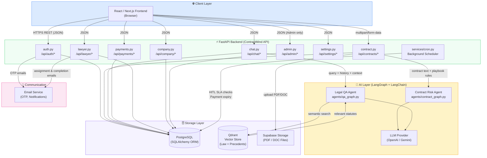
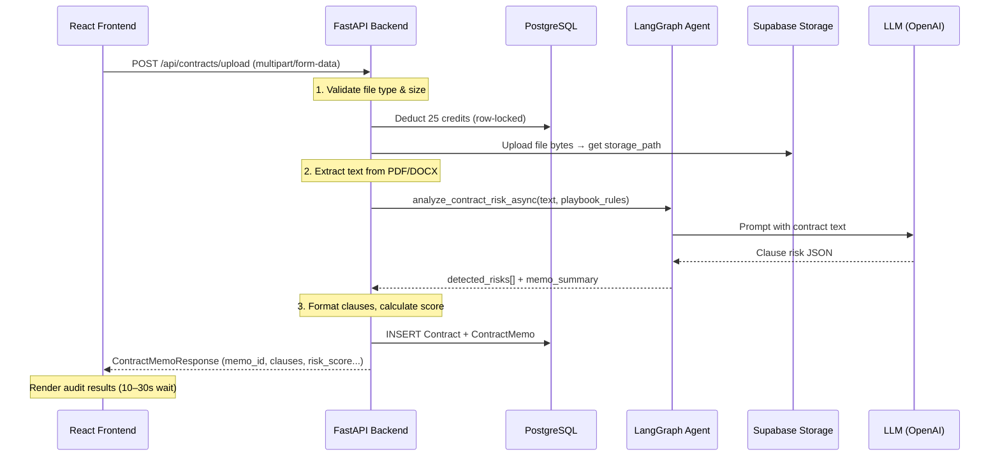
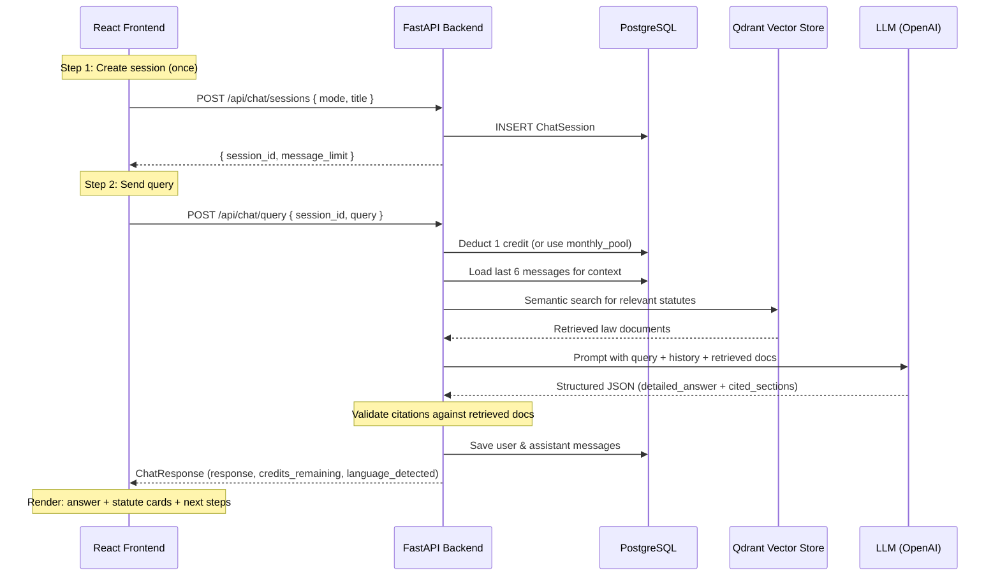
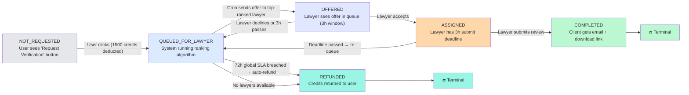
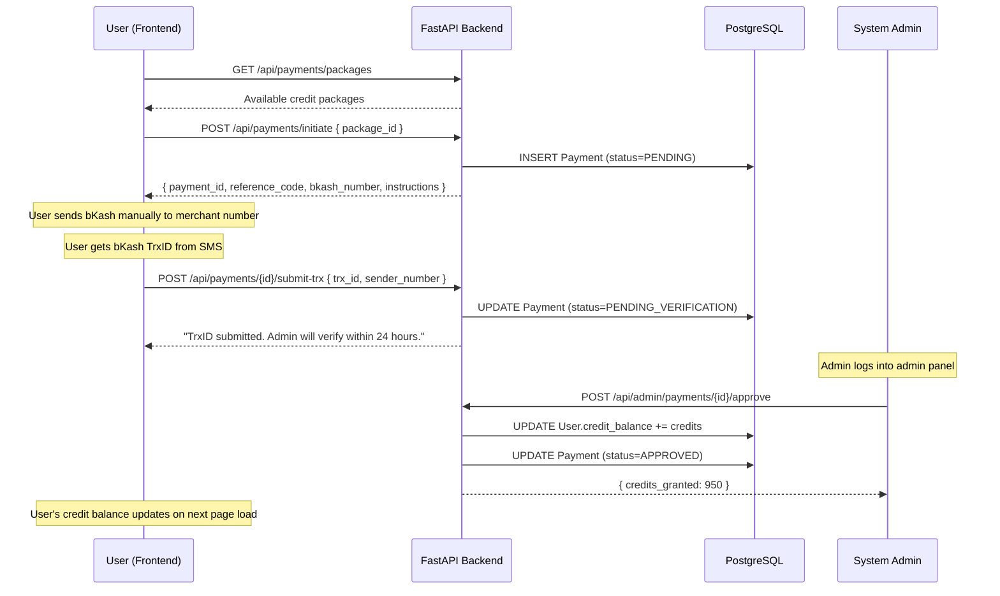

# ContractMind — Project Architecture Map

> A simplified architecture reference for the Frontend team.
> This map shows how the React/Next.js frontend relates to the backend systems,
> and what each user role's dashboard should primarily focus on.

---

## System Architecture Diagram



---

## Request Lifecycle: Contract Audit



---

## Request Lifecycle: Legal Chat Query



---

## HITL Lawyer Verification Lifecycle



---

## Data Flow: Payment (bKash Manual)



---

## 4 User Roles — Dashboard Focus

### Role 1: GENERAL User

**Who they are:** Individual users (freelancers, business owners, individuals) seeking legal help.

**JWT `role` value:** `"GENERAL"`

**Primary Dashboard:** `/dashboard`

| Section | Purpose |
|---------|---------|
| **Contract Audit** | Upload PDF/DOCX → view clause-by-clause risk analysis |
| **Legal Chat** | Ask Bangladesh law questions (RAG-powered) |
| **Request Verification** | Upgrade any audit to lawyer-verified status |
| **Credit Balance** | Current balance, top-up via bKash |
| **Contract History** | Past audits with HITL status badges |

**Key UX Concerns:**
- Always show credit balance prominently in header.
- Show "Request Lawyer Verification" CTA prominently after every AI audit.
- Warn when approaching session message limit.
- After `POST /api/auth/register/email`, force through OTP screen before showing dashboard.

---

### Role 2: LAWYER

**Who they are:** Licensed Bangladesh Bar Council attorneys who review contracts.

**JWT `role` value:** `"LAWYER"`

**Primary Dashboard:** `/lawyer/dashboard`

**Prerequisites:** Must have an approved `LawyerProfile` (admin-verified).

| Section | Purpose |
|---------|---------|
| **Offer Queue** | Live offers with countdown timers (Accept / Decline) |
| **Active Tasks** | Contracts accepted — with 3-hour submit countdown |
| **Contract Review** | View AI analysis → modify clauses → submit with notes & signature |
| **AI Research Chat** | Use `LAWYER_RESEARCH` mode to research statutes for the contract |
| **Earnings Dashboard** | Wallet balance (BDT), completed reviews, rating |
| **Withdrawal** | Request bKash payout (minimum ৳500) |

**Key UX Concerns:**
- The offer queue must feel **urgent** — show countdown timers for each offer.
- After accepting, show a clear "Submit by [deadline]" header on the review screen.
- Lawyers get **100 free chat credits/month** — show `monthly_free_chat_remaining` prominently.
- Never show BDT ↔ credit conversion rates.

---

### Role 3: ENTERPRISE_ADMIN

**Who they are:** Company administrators managing their organization's legal platform usage.

**JWT `role` value:** `"ENTERPRISE_ADMIN"`

**Primary Dashboard:** `/enterprise/dashboard`

| Section | Purpose |
|---------|---------|
| **Company Dashboard** | Member count, credit pool balance, pending approvals |
| **Member Management** | Approve/reject/suspend members, set departments |
| **Credit Quota** | Allocate per-member credit quotas from the pool |
| **Playbook** | Upload company legal policy documents (auto-parsed to rules) |
| **Analytics** | Daily credit spend chart across the organization |
| **Billing** | Top up company credit pool via bKash |
| **Referral Code** | Display the code employees use to join |

**Key UX Concerns:**
- Show `members.pending_approval` count as a notification badge.
- The referral code should be easily copyable from the dashboard.
- Quotas are **soft caps** — they don't move credits, just limit per-member spend.
- Enterprise members use the **enterprise credit pool**, not personal wallets.

---

### Role 4: ENTERPRISE_MEMBER

**Who they are:** Employees of an approved enterprise, using the platform on behalf of their company.

**JWT `role` value:** `"ENTERPRISE_MEMBER"`

**Primary Dashboard:** `/dashboard` (same route as `GENERAL`, but context-aware)

**Post-Login Gate:** If `member_approval_status !== "APPROVED"`, show an approval-pending screen — do **not** allow access.

| Section | Purpose |
|---------|---------|
| **Contract Audit** | Upload and audit contracts (cost: 50 credits from enterprise pool) |
| **Legal Chat** | Ask questions (cost: 1 credit from enterprise pool) |
| **My Quota** | Show `quota_used / quota_total` usage bar |
| **Contract History** | Their own contracts + enterprise-wide contracts |

**Key UX Concerns:**
- Replace personal credit balance with "Company Pool Balance" and personal quota bar.
- If `quota_remaining === 0`, show a message: "Your credit quota is exhausted. Contact your company admin."
- Show which enterprise they belong to (from `enterprise.name` in `/api/settings/me`).

---

## Backend Module Map

```
app/
├── main.py                  ← FastAPI app init, CORS config, router registration
├── config.py                ← Environment variables (SECRET_KEY, DB_URL, etc.)
│
├── api/                     ← HTTP route handlers (what the frontend calls)
│   ├── auth.py              ← Registration, login, OTP, onboarding
│   ├── contract.py          ← Upload, audit, HITL request, download
│   ├── chat.py              ← Sessions, queries (RAG)
│   ├── payments.py          ← bKash payment flow
│   ├── lawyer.py            ← Offer queue, task submission, earnings
│   ├── company.py           ← Enterprise member & playbook management
│   ├── settings.py          ← Profile, password, lawyer preferences
│   └── admin.py             ← System admin operations
│
├── agents/                  ← AI logic (do not call directly from frontend)
│   ├── contract_graph.py    ← LangGraph for contract risk analysis
│   ├── qa_graph.py          ← LangGraph for legal Q&A (RAG)
│   ├── nodes.py             ← Individual graph node functions
│   ├── prompts.py           ← LLM prompt templates
│   └── state.py             ← LangGraph state definitions
│
├── core/                    ← Cross-cutting concerns
│   ├── security.py          ← JWT, RBAC, credit deduction logic
│   ├── pricing.py           ← Credit costs per service (single source of truth)
│   ├── tier_limits.py       ← Chat session limits per role/tier
│   └── database.py          ← SQLAlchemy async session setup
│
├── models/                  ← SQLAlchemy ORM models
│   ├── user.py              ← User, CreditTransaction, WithdrawalRequest
│   ├── memo.py              ← Contract, ContractMemo, HITLStatus, RiskLevel
│   ├── chat.py              ← ChatSession, ChatMessage, ChatMode
│   ├── lawyer.py            ← LawyerProfile, LawyerStatus, LawyerAvailability
│   ├── playbook.py          ← Enterprise, CompanyPlaybook, CreditPackage
│   └── audit.py             ← Payment, AuditLog, PaymentStatus
│
└── services/                ← Business logic & integrations
    ├── ingestion.py         ← Extract text from PDF/DOCX/images
    ├── retriever.py         ← Qdrant vector search for statutes
    ├── llm_provider.py      ← LLM client factory
    ├── lawyer_assignment.py ← HITL ranking algorithm
    ├── email_service.py     ← OTP & notification emails
    ├── legal_normalizer.py  ← Normalize statute act/section names
    ├── playbook_parser.py   ← Parse policy docs into rules via LLM
    └── cron.py              ← Background jobs (HITL SLA, payment expiry)
```

---

## Environment Variables Frontend Needs

The frontend only needs the backend's base URL. All sensitive keys live on the server.

```env
# .env.local (Next.js)
NEXT_PUBLIC_API_URL=http://localhost:8000

# For Google OAuth on the client:
NEXT_PUBLIC_GOOGLE_CLIENT_ID=your-google-client-id.apps.googleusercontent.com
```

> **Never** put `SECRET_KEY`, `DATABASE_URL`, `SUPABASE_SERVICE_KEY`, or any AI API keys in the frontend.

---

## Key Design Decisions for Frontend

| Decision | Rationale |
|----------|-----------|
| BDT values are never shown alongside credits | Intentional — prevents users from calculating conversion rates |
| OTP expires in 5 minutes | Frontend must show a countdown timer and a Resend button |
| JWT contains `role`, `tier`, `ent_id` | Frontend can decode it for route guards without an extra API call |
| HITL uses polling, not WebSockets | Backend has cron-based advancement — poll every 30s for active HITL |
| Enterprise contracts show all members' work | Enterprise members see team-wide contract history |
| Lawyer's `CONTRACT_REVIEW` chat is free | Deduction returns `{ source: "free" }` — do not show a credit deduction alert |
| `proposed_safe_redline` can be `null` | Only show the "Suggested Fix" section when this field is non-null |
| Download URLs expire in 1 hour | Always fetch fresh on the download click — do not cache the URL |
